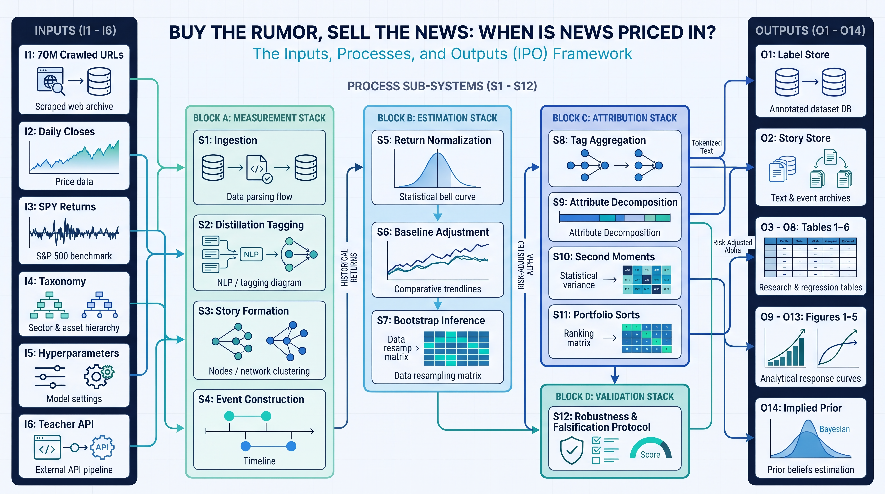

# **`README.md`**

# Buy the Rumor, Sell the News: When Is News Priced In?

<!-- PROJECT SHIELDS -->
[](https://opensource.org/licenses/MIT)
[](https://github.com/chirindaopensource/buy_the_rumor_sell_the_news)
[](https://github.com/chirindaopensource/buy_the_rumor_sell_the_news)
[](https://peps.python.org/pep-0008/)
[](https://peps.python.org/pep-0484/)
[](https://arxiv.org/abs/2608.14014)
[](https://arxiv.org/abs/2608.14014)
[](https://arxiv.org/abs/2608.14014)
[](https://arxiv.org/abs/2608.14014)
[](https://arxiv.org/abs/2608.14014)
[](https://arxiv.org/abs/2608.14014)
[](https://github.com/chirindaopensource/buy_the_rumor_sell_the_news)
[](https://github.com/chirindaopensource/buy_the_rumor_sell_the_news)
[](https://github.com/chirindaopensource/buy_the_rumor_sell_the_news)
[](https://github.com/chirindaopensource/buy_the_rumor_sell_the_news)
[](https://github.com/chirindaopensource/buy_the_rumor_sell_the_news)
[](https://github.com/chirindaopensource/buy_the_rumor_sell_the_news)
[](https://github.com/chirindaopensource/buy_the_rumor_sell_the_news)
[](https://github.com/chirindaopensource/buy_the_rumor_sell_the_news)
[](https://github.com/chirindaopensource/buy_the_rumor_sell_the_news)
[](https://github.com/chirindaopensource/buy_the_rumor_sell_the_news)
[](https://github.com/chirindaopensource/buy_the_rumor_sell_the_news)
[](https://github.com/chirindaopensource/buy_the_rumor_sell_the_news)
[](https://github.com/chirindaopensource/buy_the_rumor_sell_the_news)
[](https://github.com/chirindaopensource/buy_the_rumor_sell_the_news)
[](https://github.com/chirindaopensource/buy_the_rumor_sell_the_news)
[](https://github.com/chirindaopensource/buy_the_rumor_sell_the_news)
[](https://github.com/chirindaopensource/buy_the_rumor_sell_the_news)
[](https://github.com/chirindaopensource/buy_the_rumor_sell_the_news)
[](https://zanista.ai/)
[](https://www.ssga.com/us/en/intermediary/etfs/spdr-sp-500-etf-trust-spy)
[](https://github.com/chirindaopensource/buy_the_rumor_sell_the_news)
[](https://azure.microsoft.com/en-us/products/ai-services/openai-service)
[](https://huggingface.co/distilbert/distilroberta-base)
[](https://numpy.org/)
[](https://pandas.pydata.org/)
[](https://scipy.org/)
[](https://pytorch.org/)
[](https://arrow.apache.org/docs/python/)
[](https://matplotlib.org/)
[](https://github.com/gerrymanoim/exchange_calendars)
[](https://jinja.palletsprojects.com/)
[](https://github.com/john-kurkowski/tldextract)
[](https://faker.readthedocs.io/)
[](https://pyyaml.org/)
[](https://jupyter.org/)
[](https://github.com/chirindaopensource/buy_the_rumor_sell_the_news)
[](https://colab.research.google.com/github/chirindaopensource/buy_the_rumor_sell_the_news/blob/main/buy_the_rumor_sell_the_news_draft.ipynb)

**Repository:** `https://github.com/chirindaopensource/buy_the_rumor_sell_the_news`

**Owner:** 2026 Craig Chirinda (Open Source Projects)

> **Viewing the notebook.** The code of `buy_the_rumor_sell_the_news_draft.ipynb` is about 4.0 million characters long. If GitHub's built-in viewer does not render it fully, open it in [Google Colab](https://colab.research.google.com/github/chirindaopensource/buy_the_rumor_sell_the_news/blob/main/buy_the_rumor_sell_the_news_draft.ipynb) or [nbviewer](https://nbviewer.org/github/chirindaopensource/buy_the_rumor_sell_the_news/blob/main/buy_the_rumor_sell_the_news_draft.ipynb), or clone the repository and open it in Jupyter.

This repository contains an **independent**, professional-grade Python implementation of the arXiv preprint "*Buy the Rumor, Sell the News: When Is News Priced In?*" (arXiv:2608.14014; e-journal submission 14 August 2026, v1; revised 18 October 2026, v2), accepted at the 3rd Workshop on LLMs and Generative AI for Finance (AI4F 2026), held in conjunction with ICAIF 2026 in Milan, Italy, by:

*   **Alireza Kargarzadeh** (TailState Intelligence Ltd, London)
*   **Nariman Khaledian** (Independent Researcher, Antibes)
*   **Navid Parvini** (Zanista AI Ltd, London)
*   **Sid Ghatak** (Increase Alpha, LLC, Miami)
*   **Arman Khaledian** (Zanista AI Ltd, London)

The reference is an arXiv preprint accepted at a conference workshop, not a journal article. The authors have no part in this repository, and it is not their code. It was written from the manuscript alone, which ships no code, seeds or data.

The project implements a placebo-controlled, provenance-tracked event-feature store that sits between a stream of public text about assets and a downstream forecasting, risk or execution system. Raw prose becomes tagged, deduplicated and cost-bounded event records whose price impact is measured against an exposure-matched control of comparable stocks. The store yields a calibrated decay prior (which events carry durable directional information), a width prior (which events carry only volatility), and a built-in falsification test that strips out the benchmark residual masquerading as signal.

> **Reproduction status.** The pipeline is implemented end to end, but **no figure of the paper is reproduced here, and none can be from this repository.**
>
> - **The data are not public.** The study's corpus is NewsWitch, a commercial product of Zanista AI Ltd. Its only access route is `info@zanista.ai`, and it has no published licence, mirror or snapshot.
> - **What is verified.** All 28 stages of the pipeline orchestrator run, and so does the attribute analysis, on a synthetic world that plants the paper's mechanisms (see [Usage](#usage)). The development test suites are not published.
> - **What remains a target.** Every published number below, from 1,681,657 events to the Table 6 Sharpe ratios, is a comparison target that the code checks. It is never presented as a result.
> - **What cannot be rebuilt.** The label store itself ("criterion B") cannot be rebuilt from anything the paper publishes, and `config.yaml` records it as infeasible.

## Table of Contents

- [Introduction](#introduction)
- [Theoretical Background](#theoretical-background)
- [Features](#features)
- [Methodology Implemented](#methodology-implemented)
- [Core Components (Notebook Structure)](#core-components-notebook-structure)
- [Key Callables: `run_full_pipeline_task_29` and `run_task_34`](#key-callables-run_full_pipeline_task_29-and-run_task_34)
- [Prerequisites](#prerequisites)
- [Installation](#installation)
- [Input Data Structure](#input-data-structure)
- [Usage](#usage)
- [Output Structure](#output-structure)
- [Project Structure](#project-structure)
- [Customization](#customization)
- [Contributing](#contributing)
- [Recommended Extensions](#recommended-extensions)
- [License](#license)
- [Citation](#citation)
- [Acknowledgments](#acknowledgments)

## Introduction

This project implements the methodology of Kargarzadeh, Khaledian, Parvini, Ghatak and Khaledian (2026). Its core is the Jupyter notebook `buy_the_rumor_sell_the_news_draft.ipynb`. Its code defines **947 top-level callables: 893 functions, 28 classes and 26 methods**, counted with Python's `ast` module over top-level definitions and the methods of top-level classes (nested helper functions are not counted). The code is organised as **40 tasks**, each in its own cell. Task 29 holds the pipeline orchestrator, `run_full_pipeline_task_29`; Task 34 holds the study interface demonstrated in the usage example, `run_task_34`.

**The question.** Two market sayings hold that news is already priced in by the time it is published, and that the rumor is bought while the news is sold. Both are claims about event time: they place the news-aligned price move before and at publication, not after it. The paper asks whether they hold, for which kinds of news, and by how much.

**Why it was open.** The paper argues that three layers of measurement infrastructure were missing at the scale of the full news flow:

1. **Tagged events.** An earnings report, a lawsuit and a promotional listicle are different economic objects, so each article needs an event label, accurately, for millions of articles.
2. **Story structure.** The same event is syndicated and followed up for days, so repeated coverage must be grouped into stories before events are counted.
3. **A benchmark for publicity itself.** Separating the effect of news direction from the effect of merely being in the news needs a control: coverage with no direction.

**The design.**

- **Tagging.** A frozen-prompt LLM teacher (gpt-5-mini on Azure, about \$0.0002 per article) labels 29,472 articles with 17 event tags and five attributes. A distilroberta-base student with seven heads is trained on them and refined by active learning, then retrained on 129,463 labels and deployed on all 4.57 million articles with confidence routing back to the teacher.
- **Stories and events.** Articles are clustered into stories on whitened title-and-summary embeddings, which separates first reports (NEW) from follow-ups. Events are (stock, trading day, tag) aggregates: 1,862,297 in all, of which 1,681,657 are scored, 1,317,252 signed and 364,405 neutral.
- **Measurement.** Beta-adjusted abnormal returns are cumulated over four event windows. Neutral events serve as a placebo whose drift, by size bucket, is subtracted before the sign is applied.

**The findings the paper reports.**

1. **The move sits before and at publication.** Pooled across signed events, the cumulative move in the news direction at the close of publication day is 2.84 times its value twenty days later. Rumor-flagged events earn their return around the rumor, with little at the linked confirmation.
2. **Markets underreact to numbers and overreact to stories.** Net of the placebo, quantified fundamental news keeps drifting, while soft story-driven news reverses. A background drift, the residual of the single-beta benchmark, explains most of the raw post-news picture.
3. **News carries width as well as direction.** Neutral news raises publication-day volatility.

## Theoretical Background

The paper numbers no equations. The forms below follow its Section 4.3 and Section 5 text; where the notebook fixes a convention the paper leaves open, the convention is named.

**Abnormal returns.** With $r_{i,t}$ the stock's daily simple return and $r_{m,t}$ the S&P 500 return measured through SPY:

$$
AR_{i,t} = r_{i,t} - \beta_{i,t}\, r_{m,t},
$$

where $\beta_{i,t}$ is a rolling 252-day OLS beta as of day $t$, with a minimum of 126 observations and a missing beta set to 1:

$$
\hat\beta_{i,t}=\begin{cases}\dfrac{\sum_{s\in W_t}(r_{i,s}-\bar r_i)(r_{m,s}-\bar r_m)}{\sum_{s\in W_t}(r_{m,s}-\bar r_m)^2}, & n_t\ge 126,\\[2mm] 1, & n_t<126.\end{cases}
$$

**Event windows.** Around each event $e$ on stock $i$ at session $t_0$, abnormal returns are cumulated over four windows of exchange sessions: days $-5..0$ (which includes day 0), day 0, days $+1..+5$ and days $+6..+20$:

$$
CAR_{e,w}=\sum_{j\in w}AR_{i,t_0+j},\qquad w\in\lbrace[-5,0],\,[0,0],\,[+1,+5],\,[+6,+20]\rbrace .
$$

**The placebo baseline and the adjusted estimator.** $b_{k,w}$ is the mean abnormal return of neutral events in annual dollar-volume size bucket $k$ over window $w$. Signed events are stacked by sentiment sign $s_e\in\lbrace-1,+1\rbrace$, and the baseline is subtracted *before* the sign is applied:

$$
b_{k,w}=\frac{1}{\lvert\mathcal{N}_k\rvert}\sum_{e\in\mathcal{N}_k}CAR_{e,w},\qquad \mathrm{adj}_{e,w}=s_e\left(CAR_{e,w}-b_{k(e),w}\right),\qquad s_e\,CAR_{e,w}=\mathrm{adj}_{e,w}+s_e\,b_{k(e),w}.
$$

The identity on the right is why one negative drift appears as reversal after good news and continuation after bad news: raw post-event drift of $-0.62\%$ after positive and $+0.63\%$ after negative news both collapse to within 0.02% of zero after adjustment.

**The pooled running total.** Starting five days before publication, the average daily abnormal return in the news direction is accumulated; its ratio at day 0 to day 20 measures how complete the move was (paper: $0.579\%/0.204\%=2.84$):

$$
R(\ell)=\frac{1}{\lvert E\rvert}\sum_{e\in E}\sum_{j=-5}^{\ell}s_e\,AR_{e,j},\qquad \rho=\frac{R(0)}{R(20)} .
$$

**The falsification test.** A quiet stock-day has no event for the stock and none in the prior five trading days, so its windows measure drift with no news at all. Both the quiet days and the neutral events must drift down by comparable amounts (paper: neutral $-0.92/-0.58/-0.34\%$ and quiet $-0.74/-0.88/-0.59\%$ for small, mid and large caps):

$$
q_{i,t}=1\iff \sum_{j=0}^{5}E_{i,t-j}=0 .
$$

**Inference.** Significance comes from a bootstrap that resamples trading dates (5,000 draws), because same-day events are cross-sectionally correlated. The notebook computes the two-sided p-value on null-centred draws $d_b=\bar x_b-\bar x$ (a convention it records), re-estimating the baseline inside every draw. Across the seventeen tags it applies the Benjamini–Hochberg step-up:

$$
p=\frac{2}{B}\min\left(\#\lbrace d_b\ge \bar x\rbrace,\ \#\lbrace d_b\le \bar x\rbrace\right),\qquad q_{(j)}=\min_{l\ge j}\frac{p_{(l)}\,m}{l},\quad m=17 .
$$

**Width.** Second moments are ratios of a stock's absolute move to its own typical day, so the background drift does not enter them (paper: neutral guidance 1.29 on the day and 1.23 over the week):

$$
w(C,0)=\underset{(i,t_0)\in C}{\mathrm{mean}}\ \frac{\lvert AR_{i,t_0}\rvert}{\overline{\lvert AR\rvert}_{i,t_0}},\qquad \overline{\lvert AR\rvert}_{i,t}=\frac{1}{N}\sum_{s\in[t-252,t)}\lvert AR_{i,s}\rvert .
$$

**Economic significance.** Calendar-time portfolios open at the close of day $+5$ and close at the close of day $+20$, equally weight all open positions, rebalance daily and hedge each stock leg with a beta-sized index position:

$$
h_{i,t}=\mathrm{side}_i\left(r_{i,t}-\beta_{i,t_0}\,r_{m,t}\right),\qquad \mathrm{SR}=\sqrt{252}\,\frac{\bar r}{\hat\sigma_r}.
$$

The fading book (short positive small-cap launch and partnership news, long negative) earns a Sharpe ratio of 1.35, the same as shorting every covered small cap: the news direction adds nothing.

## Features

- **40-task modular architecture.** Each task is one notebook cell with its own final orchestrator.
- **One pipeline orchestrator.** `run_full_pipeline_task_29` runs Tasks 1 to 28 in dependency order, binds each stage's outputs to the next stage's inputs, persists every artefact with its SHA-256, writes a run manifest, and stops at the first stage whose halt rule fires.
- **Placebo by construction.** The adjusted estimator subtracts the exposure-matched neutral baseline before signing, and the quiet-day test checks that the baseline measures the benchmark residual rather than publicity.
- **Halting gates, not warnings.** Data quality (Task 2), the bootstrap label floor (Task 13), event cardinalities (Task 22), the 9.7% attrition band (Task 23), the mirror diagnostic (Task 24), the falsification (Task 26), bootstrap conservatism (Task 27) and the paper's false-discovery structure (Task 28) stop the run when they fail.
- **Provenance everywhere.** Every article records its label source and teacher stratum, every label call is idempotent and charged once, and Task 40 reconciles the paper's conservation chain from 70 million crawled articles to 1,681,657 scored events.
- **Look-ahead discipline.** Teacher prompts carry no date, price or return. Size buckets for year $y$ use year $y-1$ dollar volume, betas use only data to day $t$, and typical-day denominators use only prior sessions.
- **Exchange-calendar correctness.** Trading days come from the session calendar, with the 16:00 New York roll resolved through the timezone database, never a fixed offset.
- **Robustness, one restriction per threat.** Follow-up contamination is tested with NEW-only events (Task 31), cross-tag attribution with single-tag days (Task 32), and classifier error with teacher-only labels (Task 33). The baseline's tag pooling is tested with a tag-matched variant (Task 30).
- **Honest reporting.** Published figures are inputs and targets, never literals returned as results. Deviations are recorded with their size relative to tolerance, and Task 40's report lists every documented default and the gaps that cannot be resolved.
- **Self-contained notebook.** No task cell imports from a module folder, and every import sits in the notebook's import cell.

## Methodology Implemented

The notebook works through the paper in nine phases.

**Phase I: Data foundations (Tasks 1 to 10).**

- *Task 1* ingests the seven tables and verifies schemas, keys, referential integrity and declared targets.
- *Task 2* profiles data quality and applies the halting gates.
- *Task 3* cleanses and normalises: HTTP and robots filters, paywall and language flags, registrable domains, timezone parsing and true dollar volume.
- *Task 4* deduplicates by canonical URL and 64-bit SimHash, then assigns each article a trading day under the 16:00 New York roll.
- *Task 5* builds the ticker lifecycle, resolves articles to symbols and accounts for coverage attrition.
- *Task 6* builds the session calendar with O(1) shift primitives and a daylight-saving audit.
- *Task 7* computes simple returns, integrates delisting returns and validates the panel.
- *Task 8* computes SPY returns and the rolling 252/126 betas.
- *Task 9* computes $AR_t = r_t-\beta_t r_{m,t}$ and verifies its decomposition.
- *Task 10* forms point-in-time annual dollar-volume terciles.

**Phase II: Distilled LLM tagging (Tasks 11 to 18).**

- *Task 11* freezes the vendor gate prompt.
- *Task 12* freezes the teacher prompt and its strict seven-field JSON schema.
- *Task 13* labels the 29,472-article bootstrap sample.
- *Task 14* audits the seven-head distilroberta-base student.
- *Task 15* trains the student.
- *Task 16* runs the active-learning round, with 600,000 scored articles and the 100,000 least confident, under a rare-tag quota.
- *Task 17* retrains on the merged 129,463 labels and measures agreement: 87.5% overall and 94.0% at confidence ≥ 0.8.
- *Task 18* deploys the student with confidence routing to the teacher and records every label's provenance.

**Phase III: Stories and events (Tasks 19 to 22).**

- *Task 19* embeds and whitens the title-and-summary text.
- *Task 20* calibrates per-tag story lifetimes from similarity-decay curves.
- *Task 21* forms stories: single-link day clusters at 0.80, matched to frozen first-day centroids, which flags NEW and follow-up articles.
- *Task 22* aggregates the (stock, trading day, tag) events, with impact, sign, neutral state, attributes and attention.

**Phase IV: Measurement and inference (Tasks 23 to 28).**

- *Task 23* cumulates the four event windows and reconciles the 9.7% attrition.
- *Task 24* estimates the neutral baseline $b_{k,w}$ and its mirror diagnostic.
- *Task 25* applies the adjusted estimator, builds the tag map and computes the running total.
- *Task 26* runs the quiet stock-day falsification.
- *Task 27* runs the date-clustered bootstrap with draw-wise baseline re-estimation.
- *Task 28* applies Benjamini–Hochberg control across the 17 tags.

**Phase V: Orchestration (Task 29).** `run_full_pipeline_task_29` executes Tasks 1 to 28 and audits the run.

**Phase VI: Robustness (Tasks 30 to 33).**

- *Task 30* replaces the pooled baseline with a tag-matched one.
- *Task 31* restricts the sample to NEW-only events.
- *Task 32* restricts it to single-tag days.
- *Task 33* restricts it to teacher-only labels, with stratum weights.

**Phase VII: Analyses (Tasks 34 to 37).**

- *Task 34* conditions the drift on the five attributes.
- *Task 35* links each rumor to its later confirmation and computes the stage returns of Table 3.
- *Task 36* classifies sources into six groups, the basis of Table 5.
- *Task 37* computes the width ratios.

**Phase VIII: Economic significance (Tasks 38 and 39).** Both tasks build the three Table 6 calendar-time books, verify their Sharpe ratios over the cost grid, and test that the fading book superimposes on the direction-blind book.

**Phase IX: Reconciliation (Task 40).** Task 40 builds the conservation ledger and the dual-lens verification against the paper's targets, then renders the six tables, the five figures and the reproduction report.

The diagram below illustrates the Inputs, Processes and Outputs (IPOs) of the implemented approach:

<div align="center">
  <a href="https://github.com/chirindaopensource/buy_the_rumor_sell_the_news/blob/main/buy_the_rumor_sell_the_news_ipo_main_3.png">
    
  </a>
</div>

### Targets the pipeline checks

The paper's headline figures enter the code as targets with tolerances. They are listed here because they define what "reproduced" would mean, not because this repository has reproduced them.

"Halts" means the task stops the run on a miss; "reports" means the miss is recorded with its size relative to the tolerance.

| Quantity (paper) | Target | Checked by |
| --- | --- | --- |
| Scored events; event skip rate | 1,681,657; 9.7% | Task 23: halts outside 0.097 ± 0.005 |
| Signed and neutral events; positive share | 1,317,252 and 364,405; 73% | Task 22: halts through stage 22's rule |
| Student-teacher agreement, overall and at confidence ≥ 0.8 | 87.5% and 94.0% | Task 17: raises outside its bands |
| Follow-up share of articles | 55% | Task 21: halts outside its hard band |
| Neutral +6..+20 drift: small, mid, large | −0.92%, −0.58%, −0.34%, ±0.35 points | Task 24: halts |
| Quiet-day +6..+20 drift: small, mid, large | −0.74%, −0.88%, −0.59% | Task 26: halts on sign, tolerance or band |
| Running-total ratio, day 0 to day 20 | 2.84 | Task 25: reports |
| Adjusted +6..+20 drift: capital returns, earnings, macro | +0.35%, +0.22%, −0.34% | Task 25: reports |
| Benjamini–Hochberg classes at 5% FDR | macro, capital returns and earnings survive | Task 28: halts |
| Unquantified slice | −0.12%, $p = 0.01$ | Task 34: halts on a sign flip, reports otherwise |
| Rumor stages: rumor day, interim, news day | +0.36%, −0.09%, +0.01% | Task 35: reports |
| Press-wire pre-publication drift | −0.06% | Task 36: halts outside its band |
| Neutral guidance width, day 0 and week | 1.29 and 1.23 | Task 37: halts |
| Fade book and direction-blind book Sharpe | 1.35 and 1.35 | Task 39: reports; halts if the books fail to superimpose |

## Core Components (Notebook Structure)

All code lives in one notebook. The import cell sits under *Import Essential Modules*, and the tasks sit under *Implementation*, in the *Draft 1* section. Before them, the notebook opens with an empty code cell and seventeen markdown cells of paper and study documentation, from *Paper* to *Use Case Extraction*, none of which takes part in a run.

| Task | Title | Functions | Classes | Methods | Orchestrator |
| --- | --- | --- | --- | --- | --- |
| 1 | Input Ingestion and Structural Validation | 36 | 2 | 0 | `run_task_1` |
| 2 | Data Quality Assessment | 25 | 0 | 0 | `run_task_2` |
| 3 | Data Cleansing and Normalization | 28 | 1 | 1 | `run_task_3` |
| 4 | Article-Level Deduplication and Trading-Day Assignment | 16 | 0 | 0 | `run_task_4` |
| 5 | Security Master Construction | 11 | 0 | 0 | `run_task_5` |
| 6 | Exchange Calendar Construction | 23 | 4 | 8 | `run_task_6` |
| 7 | Price Panel and Equity Returns | 11 | 0 | 0 | `run_task_7` |
| 8 | Market Proxy and Rolling Beta | 11 | 0 | 0 | `run_task_8` |
| 9 | Abnormal Return Computation | 9 | 0 | 0 | `run_task_9` |
| 10 | Dollar Volume and Size Terciles | 12 | 0 | 0 | `run_task_10` |
| 11 | Gate Prompt Construction | 11 | 0 | 0 | `run_task_11` |
| 12 | Teacher Prompt Construction | 13 | 1 | 1 | `run_task_12` |
| 13 | Teacher Bootstrap Labeling | 16 | 0 | 0 | `run_task_13` |
| 14 | Student Architecture Construction | 23 | 0 | 0 | `run_task_14` |
| 15 | Student First-Pass Training | 39 | 1 | 0 | `run_task_15` |
| 16 | Active Learning Round | 16 | 1 | 0 | `run_task_16` |
| 17 | Student Retraining | 35 | 0 | 0 | `run_task_17` |
| 18 | Deployment Labeling and Provenance | 26 | 0 | 0 | `run_task_18` |
| 19 | Story Embedding and Whitening | 14 | 0 | 0 | `run_task_19` |
| 20 | Story Lifetime Calibration | 29 | 0 | 0 | `run_task_20` |
| 21 | Story Formation | 18 | 0 | 0 | `run_task_21` |
| 22 | Event Table Construction | 17 | 0 | 0 | `run_task_22` |
| 23 | Event-Window Cumulative Abnormal Returns | 21 | 1 | 1 | `run_task_23` |
| 24 | Placebo Baseline Estimation | 11 | 0 | 0 | `run_task_24` |
| 25 | Adjusted Estimator | 9 | 0 | 0 | `run_task_25` |
| 26 | Quiet Stock-Day Construction | 14 | 1 | 0 | `run_task_26` |
| 27 | Date-Clustered Bootstrap | 18 | 0 | 0 | `run_task_27` |
| 28 | Multiple-Testing Control | 17 | 0 | 0 | `run_task_28` |
| 29 | Master Pipeline Orchestrator | 53 | 1 | 0 | `run_full_pipeline_task_29` |
| 30 | Baseline Specification Robustness | 23 | 0 | 0 | `run_task_30` |
| 31 | NEW-Only Robustness | 23 | 1 | 0 | `run_task_31` |
| 32 | Single-Tag-Day Robustness | 14 | 0 | 0 | `run_single_tag_task_32` |
| 33 | Teacher-Only Robustness | 18 | 0 | 0 | `run_teacher_only_task_33` |
| 34 | Attribute-Conditioned Analysis | 25 | 0 | 0 | `run_task_34` |
| 35 | Rumor Linked-Pair Analysis | 8 | 0 | 0 | `run_task_35` |
| 36 | Source-Group Analysis | 28 | 1 | 1 | `run_task_36` |
| 37 | Width Analysis | 28 | 2 | 1 | `run_task_37` |
| 38 | Portfolio Construction Orchestrator | 48 | 6 | 6 | `run_task_38` |
| 39 | Calendar-time portfolio construction and the Table 6 verification | 46 | 3 | 7 | `run_portfolio_book_verification_task_39` |
| 40 | Reconciliation and Verification | 50 | 2 | 0 | `run_task_40` |
| | **Total** | **893** | **28** | **26** | |

## Key Callables: `run_full_pipeline_task_29` and `run_task_34`

### `run_full_pipeline_task_29`: the pipeline orchestrator

```python
def run_full_pipeline_task_29(
    bundle: Mapping[str, Any],
    config: Mapping[str, Any],
    overrides: Optional[Mapping[str, Any]] = None,
    *,
    output_dir: str | Path,
) -> Dict[str, Any]: ...
```

| Argument | Contract |
| --- | --- |
| `bundle["inputs"]` | Twelve inputs. The first is `raw_tables`, the seven DataFrames of [Input Data Structure](#input-data-structure). The other eleven are `gate_audit_sample` (Task 11), `prompt_probe_title` and `prompt_probe_body` (Task 12), `student_checkpoint_paths` (Task 14), `student_training_config` (Task 15), `labeled_articles_path` (Task 16), `gold_table` (Task 17), `delisting_returns` (Task 7), `paper_table1` (Task 21), and `table2_targets` and `table2_tolerances` (Task 25). |
| `bundle["services"]` | Nine callables. The teacher has three: `teacher_client`, `teacher_call` and `teacher_batch_client`. The student has four: `student_network` (a `torch.nn.Module`), `student_model`, `student_predict_fn` and `student_encode`. The other two are `story_encoder` and `tokenize_fn`. |
| `bundle["expected_hashes"]` | Optional SHA-256 digests keyed by stage name (`task_29_stage_NN`), each covering that stage's combined outputs. A stage whose digest differs halts the run with reason `output_hash_mismatch`, which makes a re-run against recorded hashes a determinism check. |
| `config` | The study configuration (`config.yaml`), forwarded to every stage. |
| `overrides` | Keyword overrides. Each must be whitelisted by some stage, and any that is not is reported as unapplied. |
| `output_dir` | The root for the run manifest, the stage work folders and the persisted artefacts. |

**Execution.** The 28 stages run in dependency order rather than numeric order; for example, the returns and betas of Tasks 7 to 9 run after the event table of Task 22. Every delegate is resolved by name from the notebook namespace on every call.

**When it stops.** The run halts at the first stage whose result matches its halt rule:

| Stage | Halts when |
| --- | --- |
| 2 | `halt` is True |
| 13 | `proceed_to_task_14` is False |
| 22 | `proceed_to_task_23` is False |
| 27 | `halt` is True |
| 28 | `halt` is True |

**Returns.** A dictionary with `status` (`completed`, or `halted` with its `reason`), `detail`, `stages` (one record per stage with its delegate, input and output hashes, wall-clock time and status), `execution_order`, `applied_overrides` and `unapplied_overrides`.

### `run_task_34`: the study interface of the usage example

```python
def run_task_34(
    events: pd.DataFrame,
    config: Mapping[str, Any],
    output_dir: str | os.PathLike[str],
    tolerances: Mapping[str, float],
) -> Dict[str, Any]: ...
```

`run_task_34` conditions the adjusted +6..+20 drift and the pre-publication drift on the five attributes (`scheduled`, `forward_looking`, `primary_source`, `quantified`, `rumor`).

- **Steps.** It runs Task 27's date-clustered bootstrap within each of the ten slices, then compares each slice with the `attribute_analysis` targets of `config.yaml`.
- **Halts.** It raises only when the `quantified = 0` slice loses the paper's reversal. Other deviations are recorded as findings.
- **Input.** Its `events` argument is built from the outputs of stages 22 and 25 by `assemble_attribute_events_task_34`, which is why the usage example runs the pipeline first.

### Callables outside the pipeline

Tasks 30 to 40 have their own entry points and run after the pipeline on its artefacts:

- the robustness cuts: `run_task_30`, `run_task_31`, `run_single_tag_task_32` and `run_teacher_only_task_33`
- the analyses: `run_task_34` to `run_task_37`
- the portfolios: `run_task_38` and `run_portfolio_book_verification_task_39`
- the reconciliation: `run_task_40`

[`key_callables_discussion.txt`](key_callables_discussion.txt) gives the inputs, processes, outputs and equations of all 40 orchestrators.

## Prerequisites

- **Python 3.13.** The verification interpreter was Python 3.13.9 (Anaconda).
- **Required at import.** The notebook's import cell imports these unconditionally: `numpy`, `pandas`, `scipy`, `matplotlib`, `pyarrow`, `torch`, `exchange_calendars`, `jinja2` and `tldextract`. The standard-library module `resource` is guarded, because it is absent on Windows.
- **Optional.** `sentence-transformers` is needed only by Task 19's default encoder; any encoder can be injected instead. It was not installed in the verification environment.
- **For the usage example only:** `Faker` and `PyYAML`.
- **Verified versions:**
  - NumPy 2.3.5, pandas 2.3.3, SciPy 1.16.3, matplotlib 3.10.6 and PyArrow 21.0.0
  - PyTorch 2.15.0 (CPU), exchange_calendars 4.13.2, Jinja2 3.1.6 and tldextract 5.1.2
  - Faker 40.44.0 and PyYAML 6.0.3
  - notebook 7.4.5 and ipykernel 6.31.0
- **Pinning.** `requirements.txt` pins exactly these package versions. Python itself is not pinned by that file.
- **Compute.** A CPU laptop is enough for the usage example, which takes about 30 seconds. A study-scale run over 4.57 million articles needs the corpus and correspondingly more time; the paper reports 125–160 articles per second for student inference on a laptop.
- **No paid service is called by the notebook itself.** The teacher model is reached only through the `teacher_*` services you supply. The study's teacher, gpt-5-mini on Azure OpenAI, costs about \$0.0002 per article, and the paper reports \$156.29 in total.

## Installation

1. **Clone the repository:**
   ```sh
   git clone https://github.com/chirindaopensource/buy_the_rumor_sell_the_news.git
   cd buy_the_rumor_sell_the_news
   ```

2. **Create and activate a virtual environment:**
   ```sh
   python -m venv .venv
   source .venv/bin/activate        # Windows PowerShell: .venv\Scripts\Activate.ps1
   ```

3. **Install the pinned packages:**
   ```sh
   python -m pip install -r requirements.txt
   ```
   This installs the verified versions of the core libraries, Faker and PyYAML for the usage example, and the Jupyter environment. `sentence-transformers` is listed but commented out. Uncomment it only if you will use Task 19's default encoder.

4. **Open the notebook:**
   ```sh
   jupyter notebook buy_the_rumor_sell_the_news_draft.ipynb
   ```

## Input Data Structure

The pipeline takes seven DataFrames in `bundle["inputs"]["raw_tables"]`, keyed by the names below. The column lists follow the study's input specification. The dtypes are those the verified run used. Task 1 checks every declared column against `config["raw_input_schemas"]` in its `{table: {"columns": {column: dtype}}}` form.

| Table | Rows in the paper | Columns |
| --- | --- | --- |
| `raw_crawl` | more than 70 million crawl fetches | 23 specified, plus 3 the code reads |
| `retained_articles` | 4.57 million gated articles | 20 specified, plus 2 the code reads |
| `raw_prices` | daily panel of 2,591 tradeable symbols | 8 |
| `symbol_master` | about 3,000 covered stocks, plus SPY | 14 |
| `exchange_calendar` | NYSE/Nasdaq sessions | 7 |
| `market_proxy_prices` | daily SPY panel | 5 |
| `labeled_articles` | one label row per retained article | 18 |

**`raw_crawl`** is the pre-gate crawler record, the ancestor of every other structure:

| Column | Type | Content |
| --- | --- | --- |
| `crawl_id` | string | fetch identifier, the idempotency key |
| `url`, `url_canonical` | string | verbatim and canonical addresses |
| `fetched_at_utc` | datetime64[ns, UTC] | crawl time, distinct from publication time |
| `http_status` | Int32 | response code |
| `content_type` | string | MIME type |
| `source_domain` | string | registrable domain, the input to the source groups |
| `title`, `body` | string | headline and full untruncated text |
| `meta_author`, `meta_section` | string | byline and section |
| `published_declared` | string | the timestamp as declared |
| `published_declared_tz` | string | its IANA zone |
| `first_published_ts_utc` | datetime64[ns, UTC] | first publication, not syndication |
| `syndication_source` | string | upstream wire, when disclosed |
| `paywall_flag` | boolean | truncated by a paywall |
| `language` | string | BCP-47 tag |
| `tickers_mentioned_raw`, `tickers_mentioned_text` | object holding list[str] | parsed tickers and their surface forms |
| `body_length_chars` | Int32 | length of the body |
| `content_simhash` | string | near-duplicate fingerprint |
| `near_duplicate_of` | string | the surviving record of a duplicate cluster |
| `robots_compliance_pass` | boolean | permitted at fetch time |
| `primary_ticker`, `publication_timestamp_utc`, `summary` | string, datetime64[ns, UTC], string | supplementary columns read by Tasks 1 to 4 |

**`retained_articles`** holds the gated articles, each with a five-level sentiment, a summary and an audit of the retention gate:

| Column | Type | Content |
| --- | --- | --- |
| `article_id`, `crawl_id` | string | keys to the label store and the crawl |
| `primary_ticker`, `related_tickers` | string | owning ticker and every ticker the article concerns |
| `company_name`, `exchange` | string | issuer and listing venue |
| `publication_timestamp_utc` | datetime64[ns, UTC] | decides the trading day |
| `source_domain` | string | as in the crawl |
| `title`, `body`, `summary` | string | text and vendor summary |
| `summary_token_count` | Int32 | summary length in tokens |
| `sentiment` | string | "Strongly Negative" to "Strongly Positive" |
| `gate_is_financial`, `gate_is_related_to_ticker`, `gate_is_important` | boolean | the gate's three decisions |
| `gate_model_version`, `gate_prompt_version` | string | null: the paper does not identify them |
| `is_published_2023`, `is_crawled_in_backfill` | boolean | backfill provenance |
| `language`, `backfill_flag` | string, boolean | supplementary columns read by Task 3 |

**`raw_prices`** holds `date` (datetime64[ns]), `symbol_id` (Int32), `close_adj`, `close_unadj` and `adjustment_factor` (float64), `volume_shares` (Int64), `adjustment_convention` (string: `total_return` or `price_return`, single-valued and equal to the proxy's), and `delisting_return` (float64).

**`symbol_master`** holds:
- the identifiers `symbol_id`, `ticker` and `company_name`
- the listing fields `exchange`, `currency` and `security_type`
- the history fields `first_price_date`, `last_price_date`, `has_price_history`, `delisted_flag` and `delisting_return`
- the ticker-reuse fields `ticker_reuse_predecessor_id` and `previous_tickers`
- `is_market_proxy` (int8), which is 1 only for SPY

**`exchange_calendar`** holds `date`, `exchange`, `session_open` and `session_close` (local wall-clock strings; `13:00` on half days), `early_close`, `late_open` and `utc_offset_hours` (−5 or −4).

**`market_proxy_prices`** holds `date`, `market_proxy_symbol` (`SPY`), `close_adj`, `close_unadj` and `adjustment_convention`.

**`labeled_articles`** is the label store as delivered:
- `article_id`
- `primary_tag` (one of the 17 tags) and `secondary_tag` (the 17 tags or `none`)
- the five boolean attributes
- `confidence` (float32) and `is_confident`
- `label_source` (`teacher` or `student`) and `teacher_stratum` (`random_bootstrap`, `active_learning`, `deployment_routed` or `unlabeled`)
- `teacher_model`, `prompt_version`, `teacher_model_version_string`, `labeled_at_utc`, `cost_usd` and `raw_response_text`

**Data access.** This repository ships no data. The NewsWitch corpus is available only by correspondence with Zanista AI Ltd (`info@zanista.ai`), under terms the paper does not publish, so do not redistribute any part of it. Price data must come from a licensed provider of adjusted daily closes.

## Usage

The section below is identical to [`usage_example.md`](usage_example.md).

## **Usage Example**

This guide demonstrates the study interface `run_task_34` of the Python reproduction of *Buy the Rumor, Sell the News: When Is News Priced In?* (Kargarzadeh, Khaledian, Parvini, Ghatak and Khaledian; AI4F 2026 at ICAIF 2026, [arXiv:2608.14014](https://arxiv.org/abs/2608.14014)). Python implementation author: **CS Chirinda**.

In this notebook `run_task_34` is the **attribute-conditioned analysis** of the paper's attribute paragraph (Section 5.3: "scheduled events show more anticipation and slightly positive adjusted drift (+0.08%, $p = 0.03$) ...; quantified articles show no drift, unquantified ones reverse ($-0.12\%$, $p = 0.01$); rumor-flagged events show the largest pre-windows"). It does not read raw tables. Its input is the event table with the five attributes and the adjusted returns $s\,(AR_w - b_{k,w})$ of Section 4.3, and those exist only after the upstream pipeline has run. The example therefore runs the study end to end:

```text
seven raw tables (Faker)  ->  run_full_pipeline_task_29 (Tasks 1-28)
                          ->  assemble_attribute_events_task_34 (Task 22 + Task 25)
                          ->  run_task_34
```

The example has five steps. Step 1 synthesises the seven raw DataFrames. Step 2 reads the existing `config.yaml` into the dictionary `config`. Step 3 sizes the configuration to the synthetic world and runs Tasks 1–28 through `run_full_pipeline_task_29`. Step 4 composes the four arguments of `run_task_34` and calls it. Step 5 reads back what it returns. Every code cell below was executed, in the order shown, against `buy_the_rumor_sell_the_news_draft.ipynb`, and every **Output** block is that cell's captured output. The **Verification record** states what ran.

**Assumptions and execution requirements.**

1. **Every callable lives in one Jupyter notebook.** All research callables and their helpers are defined in the single notebook `buy_the_rumor_sell_the_news_draft.ipynb`. Execute its import cell (*Import Essential Modules*) and then the code cells *Task 1* to *Task 40*; then append the cells below. **No folder of `.py` modules exists or is imported**: `run_task_34`, `run_full_pipeline_task_29`, `assemble_attribute_events_task_34` and every stage function are resolved from the notebook's global namespace. Because the namespace is shared, the example must not reuse a notebook global's name. It reuses exactly five, deliberately (Step 3.3), and its own constants are named so as not to collide (for example `SOURCE_DOMAINS`, because Task 2 owns `DOMAINS`).
2. **`config.yaml` already exists in the working directory** (the notebook's folder). The example reads it and never modifies it. Its JSON twin `study_config.json` carries the same parameters.
3. **Environment.** The verification interpreter was Python 3.13.9 with pandas 2.3.3, NumPy 2.3.5, PyTorch 2.15.0 (CPU), exchange_calendars 4.13.2, PyYAML 6.0.3 and Faker 40.44.0. The example imports Faker and PyYAML in addition to the notebook's own imports.
4. **The paid models are replaced by offline stand-ins.** The paper's teacher is gpt-5-mini on Azure at about \$0.0002 per article, and its story encoder is a sentence transformer. Neither is called here. Deterministic stand-ins with the same interfaces answer instead (Step 3.2), so the example spends nothing and needs no credentials.
5. **The world is small, and the example says so.** It has 8 stocks and 323 articles, against the paper's roughly 3,000 stocks and 4.57 million articles. Three things follow, and none is hidden. First, `config.yaml`'s corpus-scale counts are resized to the world without editing the file (Step 3.1). Second, five paper-scale row-count constants are substituted (Step 3.3). Third, the pipeline's own inference gate at stage 27 halts, which is the correct verdict for a world this small (Step 3.5). No inference gate is overridden.

### **The study interface: `run_task_34`**

```python
run_task_34(
    events: pd.DataFrame,
    config: Mapping[str, Any],
    output_dir: str | os.PathLike[str],
    tolerances: Mapping[str, float],
) -> Dict[str, Any]
```

| Parameter | Data structure | What it carries | Value in this example |
|---|---|---|---|
| `events` | `pd.DataFrame`, one row per event | `event_key`, `trading_date`, `is_signed`, the five attribute columns (`scheduled`, `forward_looking`, `primary_source`, `quantified`, `rumor`), `adj_post_6_20` (the adjusted +6..+20 return) and `adj_pre_5_1` (the adjusted pre-publication window, sessions −5..0), both in fraction units | Built by `assemble_attribute_events_task_34` from Task 22's events and Task 25's `adjusted_per_event` (Step 4.1) |
| `config` | nested `dict` | the study configuration; Task 34 reads `taxonomy.attribute_names`, `bootstrap` and `attribute_analysis` | `config`, read from `config.yaml` (Step 2) |
| `output_dir` | `str` or path | the folder that receives the three artefacts | `runs/usage_example/task_34` |
| `tolerances` | `Mapping[str, float]` | `adj_bar` (fraction units) and `p_value` (probability units) comparison bands | `{"adj_bar": 0.0005, "p_value": 0.02}` |

**Default input parameters.** The signature declares no defaults; every setting comes from `config.yaml` or the call:

- `taxonomy.attribute_names` = `["scheduled", "forward_looking", "primary_source", "quantified", "rumor"]`: the ten (attribute, value) slices.
- `bootstrap.resampling_unit` = `"trading_date"`, `bootstrap.n_draws` = 5,000 (Section 4.3's date-clustered bootstrap), `bootstrap.random_seed` = `null`. A null seed is unstated by the paper, and Task 34 then applies DEF21's seed of 42, so the result is reproducible.
- `attribute_analysis`: `scheduled` +0.08% at $p = 0.03$; `unscheduled` 0; `quantified` 0; `unquantified` −0.12% at $p = 0.01$; `rumor` "largest pre-windows"; `forward_looking` and `primary_source` are computed but marked `reported: false`.
- `tolerances`: Task 34 step 3 of the detailed task list states "+0.08% ± 0.05%, p ≈ 0.03 ± 0.02" for `scheduled = 1` and "−0.12% ± 0.05%, p ≈ 0.01 ± 0.01" for `quantified = 0`. The interface takes one band per quantity, so the example passes ±0.05% (0.0005) and ±0.02.

**What it does.** Step 1 aggregates the signed events into the ten slices, giving each slice's size, adjusted +6..+20 mean and pre-window mean. Step 2 runs Task 27's date-clustered bootstrap within each slice and reports each slice's p-value, percentile interval and effective cluster count. Step 3 compares each slice with `attribute_analysis`.

- **Slice means:**

$$
\bar a_{x=v}=\frac{1}{\lvert S_{x,v}\rvert}\sum_{e\in S_{x,v}} s_e\left(CAR_{e,[6,20]}-b_{k(e),[6,20]}\right),\qquad S_{x,v}=\lbrace e:x_e=v\rbrace\cap E^{\mathrm{signed}} .
$$

- **Deviations are recorded, not raised:** a deviation from a target is a finding.
- **Exactly one condition raises:** a non-negative `quantified = 0` mean, a sign flip of the paper's reversal that indicates broken attribute assignment upstream.
- **Disclosed limitation:** the ten hypotheses carry no multiple-testing control, as in the paper.

**Returns.** A dictionary with four keys:
- `attribute_conditioned` (DataFrame)
- `attribute_p_values` (DataFrame)
- `comparison` (dict)
- `paths`, the three artefacts: `attribute_conditioned.parquet`, `attribute_p_values.parquet` and `attribute_conditioned_comparison.json`

**The upstream orchestrator.** `run_full_pipeline_task_29(bundle, config, overrides=None, *, output_dir)` runs Tasks 1–28 in dependency order:

- `bundle["inputs"]` holds the seven raw tables and eleven further inputs.
- `bundle["services"]` holds nine callables.
- It persists every artefact under `output_dir/stage_outputs/` and returns `status`, `reason`, `detail`, `stages`, `execution_order`, `applied_overrides` and `unapplied_overrides`.
- It halts at the first stage whose halt rule fires: stage 2 (`halt`), stage 13 (`proceed_to_task_14 = False`), stage 22 (`proceed_to_task_23 = False`), and stages 27 and 28 (`halt`).

### **Step 1: Synthetic Data Generation (the seven raw DataFrames)**

The world is small but built to reproduce the paper's mechanisms, so every downstream gate is met for the right reason:

- **Benchmark residual.** Every stock carries a daily drift outside its single-beta benchmark equal to Section 5.2's neutral-event baselines (−0.92%, −0.58% and −0.34% over days +6..+20 for small, mid and large caps). That is the residual the placebo is designed to remove.
- **Per-tag drifts.** Signed stories in Table 2's nine headline tags drift by their adjusted +6..+20 values. Signed rumor stories drift in the rumor's direction over days −5..0.
- **Attributes follow the event type.** Results, guidance and capital returns are scheduled. The quantified fundamental tags (results, capital returns, guidance, analyst actions, financing, price commentary) are quantified. Press releases are primary sources, and "reportedly" marks a rumor. This is the paper's own reading: "markets underreact to numbers and overreact to stories".
- **Stories.** Articles come in stories of one to three on consecutive sessions, two stories per covered stock-day. Section 5.3 reports a median of two tags per stock-day, and 55% of articles are follow-ups.
- **Attrition and corporate actions.** Planted trading halts cost about 9.7% of events their price windows (Section 3). One stock has a 2-for-1 split, and one issuer was renamed.
- **Sessions.** They are real XNYS sessions from `exchange_calendars`, including the half days of 2022-11-25 and 2023-07-03 that close at 13:00.

| DataFrame | Specified columns | Supplementary columns the notebook's code reads |
|---|---|---|
| `raw_crawl` | 23 | `primary_ticker`, `publication_timestamp_utc`, `summary` |
| `retained_articles` | 20 | `language` (Task 3's English filter), `backfill_flag` |
| `raw_prices` | 8 | — |
| `symbol_master` | 14 | — |
| `exchange_calendar` | 7 | — |
| `market_proxy_prices` | 5 | — |
| `labeled_articles` | 18 (the five attributes counted separately) | — |

The supplementary columns are the ones the notebook's Tasks 1–4 read in their crawl and retention contracts. Task 1 verifies every declared column, specified and supplementary alike.

#### **Step 1.1: Imports and data-generating constants**

```python
# =============================================================================
# Step 1.1: imports and the data-generating constants
# =============================================================================
# Import postponed evaluation of annotations, as the notebook does.
from __future__ import annotations

# Import json to serialise the synthetic teacher's responses.
import json
# Import re to read the story token the synthetic encoder keys on.
import re
# Import time to measure the pipeline's wall-clock duration.
import time
# Import zlib for a process-independent CRC-32 of text.
import zlib
# Import Path for the configuration file and the output folders.
from pathlib import Path
# Import the typing names used in the signatures below.
from typing import Any, Callable, Dict, List, Mapping, Optional, Tuple

# Import the exchange calendar package that supplies real XNYS sessions.
import exchange_calendars as xc
# Import NumPy for the seeded data-generating process.
import numpy as np
# Import pandas for the seven raw DataFrames.
import pandas as pd
# Import PyYAML to read config.yaml.
import yaml
# Import Faker for realistic issuers, bylines, slugs and article prose.
from faker import Faker

# Fix the seed of every random draw in the synthetic world.
SEED: int = 20261107
# Fix the first exchange session (252 sessions precede the sample).
CALENDAR_START: str = "2022-01-03"
# Fix the last session (22 sessions after SAMPLE_END for +20 windows).
CALENDAR_END: str = "2023-08-02"
# Fix the study's sample window (the articles' publication span).
SAMPLE_START: str = "2023-01-01"
# Fix the last day of the sample window.
SAMPLE_END: str = "2023-06-30"
# Fix the market proxy named by Section 4.3 of the paper.
PROXY_SYMBOL: str = "SPY"
# Fix the proxy's internal symbol identifier.
PROXY_ID: int = 99
# Fix the number of covered common stocks in this world.
N_STOCKS: int = 8
# Fix each stock's planned size group (2 small, 3 mid, 3 large).
SIZE_PLAN: Dict[int, str] = {1: "small", 2: "small", 3: "mid", 4: "large",
                             5: "mid", 6: "mid", 7: "large", 8: "large"}
# Fix the share-volume scale that makes Task 10 reproduce the plan.
VOLUME_SCALE: Dict[str, float] = {"small": 0.1, "mid": 1.0, "large": 10.0}
# Fix the daily background drift, the Section 5.2 neutral +6..+20
# baselines (-0.92%, -0.58%, -0.34%) spread over 15 sessions.
BACKGROUND_DRIFT: Dict[str, float] = {"small": -0.0092 / 15.0,
                                      "mid": -0.0058 / 15.0,
                                      "large": -0.0034 / 15.0}
# Fix the daily idiosyncratic return volatility.
IDIO_SD: float = 0.001
# Fix the number of retained articles per covered stock.
ARTICLES_PER_STOCK: int = 40
# Fix the story sizes (articles on consecutive sessions).
STORY_SIZES: List[int] = [1, 2, 3]
# Fix the probability of each story size (follow-up share near 0.55).
STORY_SIZE_SHARES: List[float] = [0.15, 0.25, 0.60]
# Fix the planted trading halts: (symbol, sample session, length).
# An event whose [-5, +20] window touches a halted session has no
# complete price window; these halts cost about 9.7% of the events,
# the paper's skip rate (Section 3), across all three size groups.
HALTS: List[Tuple[int, int, int]] = [(2, 55, 3), (4, 25, 1), (6, 80, 2),
                                     (8, 10, 3)]
# Fix the number of URLs fetched twice under new crawl identifiers.
REFETCHED_URLS: int = 3
# Fix the 2-for-1 split: (symbol, sample session index).
SPLIT: Tuple[int, int] = (7, 70)
# Fix Task 13's bootstrap sample at this scale (paper: 29,472).
BOOTSTRAP_SAMPLE_SIZE: int = 120
# Fix Task 16's first-pass draw at this scale (paper: 600,000).
FIRST_PASS_N: int = 150
# Fix Task 16's routed sample at this scale (paper: 100,000).
ACTIVE_LEARNING_N: int = 60
# Fix Task 17's dual-label sample at this scale (paper: 10,000).
DUAL_LABEL_N: int = 80
# Fix the adjudicated gold sample at this scale (paper: 510).
GOLD_N: int = 40
# Fix the planted per-tag drift as (target, tolerance) in percent:
# the adjusted +6..+20 column of Table 2 for its nine headline tags.
PAPER_TABLE2: Dict[str, Tuple[float, float]] = {
    "Capital returns": (0.35, 0.15), "Earnings results": (0.22, 0.10),
    "Guidance, outlook": (0.13, 0.08), "Analyst action": (0.10, 0.08),
    "Macro through stock": (-0.34, 0.10),
    "Leadership, governance": (-0.18, 0.08),
    "Product launch": (-0.18, 0.08), "Competition": (-0.17, 0.08),
    "Legal, regulatory": (-0.08, 0.15)}
# Fix the planted pre-publication drift of rumor events (percent over
# sessions -5..0): rumor-flagged events show the largest pre-windows.
RUMOR_PRE_DRIFT: float = 0.30
# Fix the tags whose events can be rumor-flagged (Table 3's tags).
RUMOR_TAGS: Tuple[str, ...] = ("M&A deal", "Legal, regulatory",
                               "Product launch")
# Fix the share of stories in RUMOR_TAGS that open as rumors.
RUMOR_SHARE: float = 0.5
# Fix the quantified fundamental tags (numbers, Section 1).
QUANTIFIED_TAGS: Tuple[str, ...] = (
    "Earnings results", "Capital returns", "Guidance, outlook",
    "Analyst action", "Financing, dilution", "Price commentary")
# Fix the scheduled-disclosure tags.
SCHEDULED_TAGS: Tuple[str, ...] = ("Earnings results", "Guidance, outlook",
                                   "Capital returns")
# Fix the 17 primary tags of the frozen taxonomy (Section 4.1).
TAGS: List[str] = [
    "Earnings results", "Guidance, outlook", "Analyst action",
    "Capital returns", "M&A deal", "Legal, regulatory",
    "Insider, ownership", "Leadership, governance", "Operations, supply",
    "Financing, dilution", "Product launch", "Partnership, customer",
    "Competition", "Macro through stock", "Price commentary",
    "Other corporate", "Promotional content"]
# Fix the five binary attributes (config taxonomy.attribute_names).
ATTRIBUTES: List[str] = ["scheduled", "forward_looking", "primary_source",
                         "quantified", "rumor"]
# Fix the vendor's five sentiment strings (Section 3).
SENTIMENTS: List[str] = ["Strongly Negative", "Negative", "Neutral",
                         "Positive", "Strongly Positive"]
# Fix the source domains; the first two are press wires.
SOURCE_DOMAINS: List[str] = ["prnewswire.com", "businesswire.com",
                             "reuters.com", "marketwatch.com",
                             "finance.yahoo.com", "seekingalpha.com",
                             "cnbc.com", "benzinga.com"]
# Fix the wire that each press-wire domain syndicates.
WIRES: Dict[str, str] = {"prnewswire.com": "PR Newswire",
                         "businesswire.com": "Business Wire"}
# Fix the editorial sections recorded in the crawl metadata.
SECTIONS: List[str] = ["Markets", "Earnings", "Technology", "Business",
                       "Deals", "Economy"]
# Fix the synthetic teacher's pinned identity (Section 4.1).
TEACHER_MODEL: str = "gpt-5-mini"
# Fix the teacher's charge per successful label in US dollars.
TEACHER_COST_USD: float = 0.0002
```

#### **Step 1.2: The session axis and the text helpers**

`xnys_sessions` reads the exchange's own schedule and records each session's New York UTC offset from the timezone database, never a fixed offset. `tag_in_text` and `attributes_for` are the world's ground truth: the synthetic teacher and student read labels from the text exactly as these functions define them. `simhash64` fills the crawler's `content_simhash`; Task 4 recomputes its own fingerprint.

```python
# =============================================================================
# Step 1.2: the session axis and the text helpers
# =============================================================================


def xnys_sessions(start: str, end: str) -> pd.DataFrame:
    """
    Return the XNYS sessions between two dates with their clock times.

    Purpose
    -------
    Supply the exchange-session axis on which the 16:00 New York roll,
    the four event windows and every trading-day gap are counted.

    Inputs
    ------
    start, end : str
        Inclusive ISO dates of the first and the last session.

    Processes
    ---------
    Reads the XNYS calendar of ``exchange_calendars``, converts each
    session's open and close to New York wall-clock strings, flags early
    closes and late opens, and records the New York UTC offset from the
    timezone database, never from a fixed offset.

    Outputs
    -------
    pd.DataFrame
        Columns ``date``, ``open_local``, ``close_local``, ``early_close``,
        ``late_open`` and ``utc_offset_hours``, one row per session.

    Raises
    ------
    ValueError
        If ``start`` is not before ``end`` or no session falls between.
    """
    # Validate the order of the two dates.
    if pd.Timestamp(start) >= pd.Timestamp(end):
        # Name the invalid range.
        raise ValueError(f"start {start} must precede end {end}.")
    # Load the New York Stock Exchange calendar.
    calendar = xc.get_calendar("XNYS")
    # Read the sessions inside the closed date range.
    sessions = calendar.sessions_in_range(start, end)
    # Refuse an empty session range.
    if len(sessions) == 0:
        # Name the empty range.
        raise ValueError(f"no XNYS session between {start} and {end}.")
    # Convert each session's open instant to New York local time.
    opens = calendar.schedule.loc[sessions, "open"].dt.tz_convert(
        "America/New_York")
    # Convert each session's close instant to New York local time.
    closes = calendar.schedule.loc[sessions, "close"].dt.tz_convert(
        "America/New_York")
    # Assemble the session table.
    table = pd.DataFrame({
        # Store the session date tz-naive (a date is not an instant).
        "date": pd.DatetimeIndex(sessions).tz_localize(None),
        # Store the local open as an HH:MM string.
        "open_local": opens.dt.strftime("%H:%M").to_numpy(),
        # Store the local close as an HH:MM string (13:00 on half days).
        "close_local": closes.dt.strftime("%H:%M").to_numpy(),
    })
    # Flag the early-close sessions (close before 16:00).
    table["early_close"] = table["close_local"] < "16:00"
    # Flag the late-open sessions (open after 09:30).
    table["late_open"] = table["open_local"] > "09:30"
    # Record the New York UTC offset in hours from the tz database.
    table["utc_offset_hours"] = [
        # Read the offset of the localised session date.
        pd.Timestamp(day).tz_localize("America/New_York")
        .utcoffset().total_seconds() / 3600.0
        # Iterate over every session date.
        for day in table["date"]]
    # Return the session table.
    return table


def stable_hash(text: str) -> int:
    """
    Return a process-independent 32-bit integer of a text.

    Purpose
    -------
    Python's ``hash`` is salted per process; a CRC-32 keeps the synthetic
    labels, confidences and embeddings identical across runs.

    Inputs
    ------
    text : str
        Any text.

    Processes
    ---------
    Encodes the text as UTF-8 and computes its CRC-32.

    Outputs
    -------
    int
        A non-negative integer below 2**32.
    """
    # Hash the UTF-8 bytes of the text.
    return zlib.crc32(str(text).encode("utf-8"))


def tag_in_text(text: str) -> str:
    """
    Return the taxonomy tag that a synthetic article's text names.

    Purpose
    -------
    Give the synthetic teacher and student a ground truth: every title
    names its tag, so the labels agree with the planted world.

    Inputs
    ------
    text : str
        An article's title (and optionally more text).

    Processes
    ---------
    Looks for each of the 17 tag names, in lower case, immediately after
    an upper-case ticker (the world writes every title as "TICKER tag:
    ..."), so Faker's body prose can never name a tag, and keeps the
    longest match, which resolves nested names deterministically.

    Outputs
    -------
    str
        The tag, or ``"Other corporate"`` when no tag is named.
    """
    # Collect every tag written directly after an upper-case ticker.
    found = [tag for tag in TAGS
             if re.search(r"\b[A-Z]{3,4} " + re.escape(tag.lower()),
                          str(text))]
    # Fall back to the residual tag when none is named.
    if not found:
        # Return the taxonomy's residual category.
        return "Other corporate"
    # Return the longest (most specific) named tag.
    return max(found, key=len)


def attributes_for(text: str, tag: str) -> Dict[str, bool]:
    """
    Return the five binary attributes of a synthetic article.

    Purpose
    -------
    Encode the paper's attribute semantics: scheduled disclosures and
    quantified fundamentals are properties of the event type, primary
    sources are press releases, and rumors are reported as such.

    Inputs
    ------
    text : str
        The article text (title and body).
    tag : str
        The article's primary tag.

    Processes
    ---------
    Sets ``scheduled`` for results, guidance and capital returns;
    ``quantified`` for the quantified fundamental tags; ``rumor`` when
    the text says "reportedly"; ``primary_source`` when the body is a
    press release; and ``forward_looking`` for guidance and analyst
    actions, plus a stable one-in-five share of the rest.

    Outputs
    -------
    Dict[str, bool]
        One boolean per attribute in :data:`ATTRIBUTES`.

    Raises
    ------
    ValueError
        If ``tag`` is not one of the 17 taxonomy tags.
    """
    # Validate the tag against the taxonomy.
    if tag not in TAGS:
        # Name the unknown tag.
        raise ValueError(f"unknown tag {tag!r}.")
    # Lower-case the text once.
    lowered = str(text).lower()
    # Return the five attributes.
    return {
        # Scheduled: an announced disclosure date.
        "scheduled": tag in SCHEDULED_TAGS,
        # Forward looking: guidance, analyst views, or a stable fifth.
        "forward_looking": (tag in ("Guidance, outlook", "Analyst action")
                            or stable_hash(lowered) % 5 == 0),
        # Primary source: the body is the company's own release.
        "primary_source": lowered.find("press release") >= 0,
        # Quantified: the event reports numbers.
        "quantified": tag in QUANTIFIED_TAGS,
        # Rumor: the article reports unconfirmed information.
        "rumor": lowered.find("reportedly") >= 0,
    }


def simhash64(text: str) -> str:
    """
    Return the 64-bit SimHash of a text as 16 hexadecimal characters.

    Purpose
    -------
    Populate ``raw_crawl.content_simhash`` the way a crawler records a
    near-duplicate fingerprint (Task 4 recomputes its own).

    Inputs
    ------
    text : str
        The article body.

    Processes
    ---------
    Hashes every whitespace token with BLAKE2b to 64 bits, sums +1/-1 per
    bit position over the tokens, and keeps the sign pattern.

    Outputs
    -------
    str
        The fingerprint, zero-padded to 16 hexadecimal digits.
    """
    # Import hashlib locally to keep the cell's imports explicit.
    import hashlib
    # Start one signed counter per bit position.
    weights = np.zeros(64, dtype=np.int64)
    # Walk over the whitespace tokens of the text.
    for token in str(text).split():
        # Hash the token to a 64-bit integer.
        value = int.from_bytes(hashlib.blake2b(
            token.encode("utf-8"), digest_size=8).digest(), "big")
        # Expand the integer to its 64 bits (Python ints, no overflow).
        bits = np.array([(value >> i) & 1 for i in range(64)],
                        dtype=np.int64)
        # Add +1 for a set bit and -1 for a clear bit.
        weights += 2 * bits - 1
    # Keep the positions whose counter is positive.
    fingerprint = int(sum(1 << int(i) for i in np.flatnonzero(weights > 0)))
    # Format the fingerprint as 16 hexadecimal digits.
    return f"{fingerprint:016x}"
```

#### **Step 1.3: Building the seven tables**

```python
# =============================================================================
# Step 1.3: the seven raw DataFrames
# =============================================================================


def build_world(seed: int = SEED) -> Tuple[Dict[str, pd.DataFrame],
                                           Dict[str, Any]]:
    """
    Generate the seven raw tables of the study and the world's truth.

    Purpose
    -------
    Produce a small, internally consistent NewsWitch-shaped world whose
    structure reproduces the paper's mechanisms: a single-beta benchmark
    residual of the Section 5.2 size (the background drift), the Table 2
    per-tag drifts, the attribute semantics of Section 5.3, rumor
    pre-publication drift, stories with follow-up coverage, a 2-for-1
    split, and trading halts that cost events their price windows.

    Inputs
    ------
    seed : int, optional
        The seed of every random draw (NumPy and Faker).

    Processes
    ---------
    1. Builds the XNYS calendar and a geometric random-walk SPY level.
    2. Builds each stock's returns as beta times the market return plus
       its size group's background drift plus idiosyncratic noise.
    3. Writes 40 articles per stock in stories of one to three articles
       on consecutive sessions, two stories per covered stock-day.
    4. Plants the Table 2 drift on days +6..+20 after each signed story of
       a headline tag, and the rumor drift on days -5..0.
    5. Removes the halted sessions, applies the split to the unadjusted
       close, and writes the crawl, including four records that Task 3
       drops and three re-fetches of one URL each.

    Outputs
    -------
    Tuple[Dict[str, pd.DataFrame], Dict[str, Any]]
        The seven tables keyed by Task 1's table names, and a truth record
        with the planned event count and the generator's settings.

    Raises
    ------
    TypeError
        If ``seed`` is not an integer.
    RuntimeError
        If a generated title fails to name its own tag.
    """
    # Validate the seed's type.
    if not isinstance(seed, int) or isinstance(seed, bool):
        # Name the invalid seed.
        raise TypeError(f"seed must be an int; received {seed!r}.")
    # Create the seeded NumPy generator.
    rng = np.random.default_rng(seed)
    # Create a seeded Faker instance (en_US).
    fake = Faker("en_US")
    # Seed this Faker instance so the prose is reproducible.
    fake.seed_instance(seed)
    # Build the session axis.
    cal = xnys_sessions(CALENDAR_START, CALENDAR_END)
    # Keep the session dates as an index.
    sessions = pd.DatetimeIndex(cal["date"])
    # Count the sessions.
    n_days = len(sessions)

    # --- exchange_calendar (7 columns) -------------------------------------
    exchange_calendar = pd.DataFrame({
        # The session date, tz-naive.
        "date": pd.Series(sessions.values, dtype="datetime64[ns]"),
        # The listing exchange whose session this is.
        "exchange": pd.Series(["XNYS"] * n_days, dtype="string"),
        # The local open as a wall-clock string.
        "session_open": cal["open_local"].astype("string"),
        # The actual local close (13:00 on half days).
        "session_close": cal["close_local"].astype("string"),
        # The half-day flag.
        "early_close": cal["early_close"].astype("boolean"),
        # The late-open flag.
        "late_open": cal["late_open"].astype("boolean"),
        # The New York UTC offset in hours (-5 or -4).
        "utc_offset_hours": cal["utc_offset_hours"].astype("float64"),
    })

    # --- market_proxy_prices (5 columns) -----------------------------------
    # Draw SPY's daily return.
    market_ret = rng.normal(0.0003, 0.01, n_days)
    # Compound it into an adjusted level.
    market_level = 400.0 * np.exp(np.cumsum(market_ret))
    # Assemble the proxy panel.
    market_proxy_prices = pd.DataFrame({
        # The session date.
        "date": pd.Series(sessions.values, dtype="datetime64[ns]"),
        # The proxy the paper names.
        "market_proxy_symbol": pd.Series([PROXY_SYMBOL] * n_days,
                                         dtype="string"),
        # The total-return adjusted close.
        "close_adj": pd.Series(market_level, dtype="float64"),
        # The unadjusted close (dividends netted out by 1.3% a year).
        "close_unadj": pd.Series(
            market_level * np.exp(0.013 * np.arange(n_days) / 252.0),
            dtype="float64"),
        # The adjustment convention, identical to the stock panel's.
        "adjustment_convention": pd.Series(["total_return"] * n_days,
                                           dtype="string"),
    })

    # --- issuers (Faker) ---------------------------------------------------
    # Draw distinct company names and derive distinct tickers.
    names: List[str] = []
    # Keep the tickers already taken.
    tickers: List[str] = []
    # Draw until there are N_STOCKS issuers.
    while len(tickers) < N_STOCKS:
        # Draw a company name.
        name = fake.company()
        # Derive a ticker from the name's initial letters.
        letters = re.sub(r"[^A-Z]", "", name.upper())
        # Keep three or four letters.
        ticker = letters[:4] if len(letters) >= 4 else (letters + "XQZ")[:3]
        # Reject a duplicate ticker or a tag word in the name.
        if ticker in tickers or tag_in_text(name) != "Other corporate":
            # Draw again.
            continue
        # Record the issuer.
        names.append(name)
        # Record its ticker.
        tickers.append(ticker)

    # --- stories and articles ----------------------------------------------
    # Keep the sample-window sessions.
    sample_sessions = sessions[(sessions >= SAMPLE_START)
                               & (sessions <= SAMPLE_END)]
    # Start the article rows.
    rows: List[Dict[str, Any]] = []
    # Start the story records (symbol, first session, tag, polarity, rumor).
    stories: List[Tuple[int, int, str, int, bool]] = []
    # Count articles and stories.
    counter = 0
    # Count stories across stocks so the tags cycle through the taxonomy.
    story_counter = 0
    # Walk over the covered stocks.
    for symbol_index, ticker in enumerate(tickers, start=1):
        # Count the articles written for this stock.
        written = 0
        # Write stories until the stock has its articles.
        while written < ARTICLES_PER_STOCK:
            # Draw the first session of a pair of same-day stories.
            start = int(rng.integers(0, len(sample_sessions)
                                     - max(STORY_SIZES)))
            # Draw the pair's polarity once: 0-1 negative, 2 neutral,
            # 3-4 positive. Companions share it, so an article the student
            # misreads into its companion's tag never creates a mixed
            # event (Task 22 caps the mixed share at 0.1%).
            pair_polarity = int(rng.integers(0, 5))
            # Write two stories with different tags on that day.
            for _companion in range(2):
                # Draw the story's size, capped at the remaining quota.
                size = int(min(rng.choice(STORY_SIZES, p=STORY_SIZE_SHARES),
                               ARTICLES_PER_STOCK - written))
                # Stop when the quota is exhausted.
                if size == 0:
                    # Leave the companion loop.
                    break
                # Cycle the tag through the taxonomy.
                tag = TAGS[story_counter % len(TAGS)]
                # Name the story.
                story = f"S{story_counter:04d}"
                # The story takes the pair's polarity.
                polarity = pair_polarity
                # Keep the story's sentiment levels on one side of zero.
                levels = ([2] if polarity == 2
                          else ([0, 1] if polarity < 2 else [3, 4]))
                # Open a signed story in a rumor tag as a rumor, at random.
                is_rumor = bool(tag in RUMOR_TAGS and polarity != 2
                                and rng.random() < RUMOR_SHARE)
                # Record the story.
                stories.append((symbol_index, start, tag, polarity, is_rumor))
                # Write the story's articles on consecutive sessions.
                for step in range(size):
                    # The article's session.
                    day = sample_sessions[start + step]
                    # Allow after-close times only on one-article stories.
                    hours = ([8, 10, 12, 14, 15, 17, 19] if size == 1
                             else [8, 10, 12, 14, 15])
                    # Draw the local publication hour.
                    hour = int(rng.choice(hours))
                    # Build the New York publication instant.
                    local = (day + pd.Timedelta(
                        hours=hour, minutes=int(rng.integers(0, 60)))
                    ).tz_localize("America/New_York")
                    # Assign the outlet in rotation.
                    domain = SOURCE_DOMAINS[counter % len(SOURCE_DOMAINS)]
                    # Only the first article of a rumor story is a rumor.
                    rumor_word = (" reportedly" if is_rumor and step == 0
                                  else "")
                    # Compose the title: ticker first, then the tag.
                    title = (f"{ticker} {tag.lower()}{rumor_word}: "
                             f"{fake.catch_phrase()}")
                    # Refuse a title whose words name another tag.
                    if tag_in_text(title) != tag:
                        # Name the defective title.
                        raise RuntimeError(f"title {title!r} misnames "
                                           f"its tag {tag!r}.")
                    # Open press-wire bodies as the company's own release.
                    lead = ("PRESS RELEASE. " if domain in WIRES else "")
                    # Compose the body from Faker prose.
                    body = lead + " ".join(fake.paragraphs(nb=4))
                    # Compose the vendor summary; the story token keys the
                    # synthetic story encoder of Step 3.
                    summary = (f"{ticker} ({names[symbol_index - 1]}) "
                               f"{tag.lower()} coverage, story {story}: "
                               f"{fake.sentence(nb_words=12)}")
                    # Record the article.
                    rows.append({
                        "crawl_id": f"C{counter:05d}",
                        "article_id": f"A{counter:05d}",
                        "symbol": symbol_index, "ticker": ticker,
                        "company": names[symbol_index - 1],
                        "local": local, "tag": tag, "domain": domain,
                        "sentiment": SENTIMENTS[int(rng.choice(levels))],
                        "title": title, "summary": summary, "body": body,
                        "author": fake.name(),
                        "section": SECTIONS[counter % len(SECTIONS)],
                        "slug": fake.slug(),
                    })
                    # Advance the article counter.
                    counter += 1
                # Count the story's articles against the quota.
                written += size
                # Advance the story counter.
                story_counter += 1

    # --- planted drifts on the price paths ---------------------------------
    # Start one extra daily return per stock and session.
    extra = np.zeros((N_STOCKS, n_days))
    # Walk over the stories.
    for symbol_index, start, tag, polarity, is_rumor in stories:
        # Neutral stories carry no direction.
        if polarity == 2:
            # Skip the neutral story.
            continue
        # The story's sentiment sign s.
        sign = 1.0 if polarity > 2 else -1.0
        # The session position of the story's first day.
        day0 = int(sessions.get_loc(sample_sessions[start]))
        # Plant the Table 2 drift over days +6..+20 (15 sessions).
        if tag in PAPER_TABLE2:
            # Add s * target / 15 to each of the 15 sessions.
            extra[symbol_index - 1, day0 + 6:day0 + 21] += (
                sign * PAPER_TABLE2[tag][0] / 100.0 / 15.0)
        # Plant the rumor's pre-publication drift over days -5..0.
        if is_rumor:
            # Add s * drift / 6 to each of the six sessions.
            extra[symbol_index - 1, day0 - 5:day0 + 1] += (
                sign * RUMOR_PRE_DRIFT / 100.0 / 6.0)

    # --- raw_prices (8 columns) --------------------------------------------
    # Start the per-stock panels.
    panels: List[pd.DataFrame] = []
    # Walk over the stocks.
    for index in range(1, N_STOCKS + 1):
        # The stock's beta to SPY.
        beta = 0.6 + 0.12 * index
        # The stock's size group.
        group = SIZE_PLAN[index]
        # The daily return: beta * r_m + drift + noise + planted drift.
        returns = (beta * market_ret + BACKGROUND_DRIFT[group]
                   + rng.normal(0.0, IDIO_SD, n_days) + extra[index - 1])
        # The adjusted close.
        close_adj = (20.0 + 10.0 * index) * np.exp(np.cumsum(returns))
        # The cumulative adjustment factor (1 unless split below).
        factor = np.ones(n_days)
        # The share volume, scaled by the size group.
        volume = np.round(rng.integers(200_000, 2_000_000, n_days)
                          * VOLUME_SCALE[group]).astype("int64")
        # Apply the 2-for-1 split to its stock.
        if index == SPLIT[0]:
            # The split session's position.
            split_at = int(sessions.get_loc(sample_sessions[SPLIT[1]]))
            # Back-adjust: before the split the factor is one half.
            factor[:split_at] = 0.5
            # Before the split fewer shares traded (same dollar value).
            volume[:split_at] = volume[:split_at] // 2
        # Assemble the stock's panel.
        panels.append(pd.DataFrame({
            "date": pd.Series(sessions.values, dtype="datetime64[ns]"),
            "symbol_id": pd.Series([index] * n_days, dtype="Int32"),
            "close_adj": pd.Series(close_adj, dtype="float64"),
            # close_adj = close_unadj * adjustment_factor.
            "close_unadj": pd.Series(close_adj / factor, dtype="float64"),
            "adjustment_factor": pd.Series(factor, dtype="float64"),
            "volume_shares": pd.Series(volume, dtype="Int64"),
            "adjustment_convention": pd.Series(["total_return"] * n_days,
                                               dtype="string"),
            # No stock delists in this window: null on every session.
            "delisting_return": pd.Series([np.nan] * n_days,
                                          dtype="float64"),
        }))
    # Stack the stock panels.
    raw_prices = pd.concat(panels, ignore_index=True)
    # Remove the halted sessions (no print, so no return).
    halted = pd.Series(False, index=raw_prices.index)
    # Walk over the planted halts.
    for symbol_id, first, length in HALTS:
        # The halted session dates.
        days = sample_sessions[first:first + length]
        # Mark the stock's rows on those dates.
        halted |= ((raw_prices["symbol_id"] == symbol_id)
                   & raw_prices["date"].isin(days))
    # Drop the halted rows.
    raw_prices = raw_prices.loc[~halted].reset_index(drop=True)

    # --- symbol_master (14 columns) ----------------------------------------
    # Count the issuers including the proxy.
    n_all = N_STOCKS + 1
    # Assemble the security master.
    symbol_master = pd.DataFrame({
        "symbol_id": pd.Series(list(range(1, N_STOCKS + 1)) + [PROXY_ID],
                               dtype="Int32"),
        "ticker": pd.Series(tickers + [PROXY_SYMBOL], dtype="string"),
        "company_name": pd.Series(names + ["SPDR S&P 500 ETF Trust"],
                                  dtype="string"),
        "exchange": pd.Series(["XNYS"] * n_all, dtype="string"),
        "currency": pd.Series(["USD"] * n_all, dtype="string"),
        "security_type": pd.Series(["common_stock"] * N_STOCKS + ["etf"],
                                   dtype="string"),
        "first_price_date": pd.Series([sessions[0]] * n_all,
                                      dtype="datetime64[ns]"),
        "last_price_date": pd.Series([sessions[-1]] * n_all,
                                     dtype="datetime64[ns]"),
        "has_price_history": pd.Series([True] * n_all, dtype="boolean"),
        "delisted_flag": pd.Series([False] * n_all, dtype="boolean"),
        "delisting_return": pd.Series([np.nan] * n_all, dtype="float64"),
        "ticker_reuse_predecessor_id": pd.Series([pd.NA] * n_all,
                                                 dtype="Int32"),
        # One renamed issuer: stock 7 previously traded as OLDT.
        "previous_tickers": pd.Series([None] * 6 + ["OLDT", None, None],
                                      dtype="string"),
        "is_market_proxy": pd.Series([0] * N_STOCKS + [1], dtype="int8"),
    })

    # --- the planted syndicated copy and the re-fetches --------------------
    # The second story's article of stock 2 repeats stock 2's first body.
    rows[ARTICLES_PER_STOCK + 1]["body"] = rows[ARTICLES_PER_STOCK]["body"]
    # Record which crawl record the copy duplicates.
    rows[ARTICLES_PER_STOCK + 1]["dup_of"] = rows[ARTICLES_PER_STOCK][
        "crawl_id"]
    # Re-fetch one URL of each of the first REFETCHED_URLS stocks.
    for stock in range(REFETCHED_URLS):
        # The source article.
        source = rows[stock * ARTICLES_PER_STOCK + 4]
        # Copy it as a second fetch, two hours later.
        again = dict(source)
        # A re-fetch carries a new crawl and article identifier.
        again["crawl_id"] = f"R{stock:05d}"
        # Its retained article identifier.
        again["article_id"] = f"R{stock:05d}"
        # It points at the same URL as its source.
        again["url_of"] = source["crawl_id"]
        # It is fetched two hours later.
        again["local"] = source["local"] + pd.Timedelta(hours=2)
        # Append the re-fetch.
        rows.append(again)

    # --- raw_crawl (23 specified + 3 supplementary columns) ----------------
    # Start the crawl records.
    crawl: List[Dict[str, Any]] = []
    # Walk over the articles.
    for row in rows:
        # The URL path is the original article's when re-fetched.
        anchor = row.get("url_of", row["crawl_id"])
        # The publication instant in UTC.
        published_utc = row["local"].tz_convert("UTC")
        # Record the crawl row.
        crawl.append({
            "crawl_id": row["crawl_id"],
            "url": (f"https://{row['domain']}/"
                    f"{row['local']:%Y/%m/%d}/{row['slug']}-{anchor}"
                    f"?utm_source=newswitch&utm_medium=feed"),
            "url_canonical": (f"https://{row['domain']}/"
                              f"{row['local']:%Y/%m/%d}/{row['slug']}"
                              f"-{anchor}"),
            "fetched_at_utc": published_utc + pd.Timedelta(minutes=20),
            "http_status": 200, "content_type": "text/html",
            "source_domain": row["domain"], "title": row["title"],
            "body": row["body"], "meta_author": row["author"],
            "meta_section": row["section"],
            "published_declared": f"{row['local']:%Y-%m-%d %H:%M:%S}",
            "published_declared_tz": "America/New_York",
            "first_published_ts_utc": published_utc,
            "syndication_source": WIRES.get(row["domain"]),
            "paywall_flag": False, "language": "en",
            "tickers_mentioned_raw": [row["ticker"]],
            "tickers_mentioned_text": [f"${row['ticker']}", row["company"]],
            "body_length_chars": len(row["body"]),
            "content_simhash": simhash64(row["body"]),
            "near_duplicate_of": row.get("dup_of"),
            "robots_compliance_pass": True,
            "primary_ticker": row["ticker"],
            "publication_timestamp_utc": published_utc,
            "summary": row["summary"],
        })
    # The four crawl-only records Task 3 drops (404, robots, paywall, fr).
    dropped = [
        {"http_status": 404, "robots_compliance_pass": True,
         "paywall_flag": False, "length": 900, "language": "en"},
        {"http_status": 200, "robots_compliance_pass": False,
         "paywall_flag": False, "length": 900, "language": "en"},
        {"http_status": 200, "robots_compliance_pass": True,
         "paywall_flag": True, "length": 120, "language": "en"},
        {"http_status": 200, "robots_compliance_pass": True,
         "paywall_flag": False, "length": 900, "language": "fr"},
    ]
    # Walk over the dropped cases.
    for offset, case in enumerate(dropped):
        # Its crawl identifier.
        crawl_id = f"X{offset:05d}"
        # Its local publication instant.
        local = (sample_sessions[5 + offset] + pd.Timedelta(hours=11)
                 ).tz_localize("America/New_York")
        # Its body of the planned length.
        body = ("z" * (case["length"] - 1)) + str(offset)
        # Record the dropped crawl row.
        crawl.append({
            "crawl_id": crawl_id,
            "url": f"https://dropped.example/{crawl_id}",
            "url_canonical": f"https://dropped.example/{crawl_id}",
            "fetched_at_utc": local.tz_convert("UTC")
            + pd.Timedelta(minutes=20),
            "http_status": case["http_status"],
            "content_type": "text/html",
            "source_domain": "dropped.example",
            "title": f"dropped record {offset}", "body": body,
            "meta_author": None, "meta_section": None,
            "published_declared": f"{local:%Y-%m-%d %H:%M:%S}",
            "published_declared_tz": "America/New_York",
            "first_published_ts_utc": local.tz_convert("UTC"),
            "syndication_source": None,
            "paywall_flag": case["paywall_flag"],
            "language": case["language"],
            "tickers_mentioned_raw": [tickers[offset]],
            "tickers_mentioned_text": [tickers[offset]],
            "body_length_chars": len(body),
            "content_simhash": simhash64(body),
            "near_duplicate_of": None,
            "robots_compliance_pass": case["robots_compliance_pass"],
            "primary_ticker": tickers[offset],
            "publication_timestamp_utc": local.tz_convert("UTC"),
            "summary": f"dropped record {offset}",
        })
    # Frame the crawl.
    crawl_frame = pd.DataFrame(crawl)
    # Cast every column to its declared dtype.
    raw_crawl = pd.DataFrame({
        "crawl_id": crawl_frame["crawl_id"].astype("string"),
        "url": crawl_frame["url"].astype("string"),
        "url_canonical": crawl_frame["url_canonical"].astype("string"),
        "fetched_at_utc": pd.to_datetime(crawl_frame["fetched_at_utc"],
                                         utc=True),
        "http_status": crawl_frame["http_status"].astype("Int32"),
        "content_type": crawl_frame["content_type"].astype("string"),
        "source_domain": crawl_frame["source_domain"].astype("string"),
        "title": crawl_frame["title"].astype("string"),
        "body": crawl_frame["body"].astype("string"),
        "meta_author": crawl_frame["meta_author"].astype("string"),
        "meta_section": crawl_frame["meta_section"].astype("string"),
        "published_declared": crawl_frame["published_declared"]
        .astype("string"),
        "published_declared_tz": crawl_frame["published_declared_tz"]
        .astype("string"),
        "first_published_ts_utc": pd.to_datetime(
            crawl_frame["first_published_ts_utc"], utc=True),
        "syndication_source": crawl_frame["syndication_source"]
        .astype("string"),
        "paywall_flag": crawl_frame["paywall_flag"].astype("boolean"),
        "language": crawl_frame["language"].astype("string"),
        "tickers_mentioned_raw": crawl_frame["tickers_mentioned_raw"],
        "tickers_mentioned_text": crawl_frame["tickers_mentioned_text"],
        "body_length_chars": crawl_frame["body_length_chars"]
        .astype("Int32"),
        "content_simhash": crawl_frame["content_simhash"].astype("string"),
        "near_duplicate_of": crawl_frame["near_duplicate_of"]
        .astype("string"),
        "robots_compliance_pass": crawl_frame["robots_compliance_pass"]
        .astype("boolean"),
        "primary_ticker": crawl_frame["primary_ticker"].astype("string"),
        "publication_timestamp_utc": pd.to_datetime(
            crawl_frame["publication_timestamp_utc"], utc=True),
        "summary": crawl_frame["summary"].astype("string"),
    })

    # --- retained_articles (20 specified + 2 supplementary columns) --------
    # Frame the articles.
    articles = pd.DataFrame(rows)
    # Count them.
    n_articles = len(articles)
    # Assemble the retained corpus.
    retained_articles = pd.DataFrame({
        "article_id": articles["article_id"].astype("string"),
        "crawl_id": articles["crawl_id"].astype("string"),
        "primary_ticker": articles["ticker"].astype("string"),
        "related_tickers": articles["ticker"].astype("string"),
        "company_name": articles["company"].astype("string"),
        "exchange": pd.Series(["XNYS"] * n_articles, dtype="string"),
        "publication_timestamp_utc": pd.to_datetime(
            [t.tz_convert("UTC") for t in articles["local"]], utc=True),
        "source_domain": articles["domain"].astype("string"),
        "title": articles["title"].astype("string"),
        "body": articles["body"].astype("string"),
        "summary": articles["summary"].astype("string"),
        "summary_token_count": pd.Series(
            [len(str(s).split()) for s in articles["summary"]],
            dtype="Int32"),
        "sentiment": articles["sentiment"].astype("string"),
        "gate_is_financial": pd.Series([True] * n_articles,
                                       dtype="boolean"),
        "gate_is_related_to_ticker": pd.Series([True] * n_articles,
                                               dtype="boolean"),
        "gate_is_important": pd.Series([True] * n_articles,
                                       dtype="boolean"),
        "gate_model_version": pd.Series([pd.NA] * n_articles,
                                        dtype="string"),
        "gate_prompt_version": pd.Series([pd.NA] * n_articles,
                                         dtype="string"),
        "is_published_2023": pd.Series(
            [t.year == 2023 for t in articles["local"]], dtype="boolean"),
        "is_crawled_in_backfill": pd.Series([True] * n_articles,
                                            dtype="boolean"),
        "language": pd.Series(["en"] * n_articles, dtype="string"),
        "backfill_flag": pd.Series([True] * n_articles, dtype="boolean"),
    })

    # --- labeled_articles (18 columns) -------------------------------------
    # Draw the delivered store's max-softmax confidences.
    confidence = rng.uniform(0.55, 0.99, n_articles).astype("float32")
    # The first BOOTSTRAP_SAMPLE_SIZE rows are the random teacher sample.
    is_teacher = np.arange(n_articles) < BOOTSTRAP_SAMPLE_SIZE
    # The texts the labels describe.
    texts = (articles["title"] + " " + articles["body"]).tolist()
    # The attribute rows of every article.
    attribute_rows = [attributes_for(text, tag)
                      for text, tag in zip(texts, articles["tag"])]
    # Assemble the label store as delivered.
    labeled_articles = pd.DataFrame({
        "article_id": articles["article_id"].astype("string"),
        "primary_tag": articles["tag"].astype("string"),
        "secondary_tag": pd.Series(["none"] * n_articles, dtype="string"),
        **{name: pd.Series([row[name] for row in attribute_rows],
                           dtype="boolean") for name in ATTRIBUTES},
        "confidence": pd.Series(confidence, dtype="float32"),
        "label_source": pd.Series(np.where(is_teacher, "teacher",
                                           "student"), dtype="string"),
        "teacher_stratum": pd.Series(np.where(is_teacher,
                                              "random_bootstrap",
                                              "unlabeled"), dtype="string"),
        "teacher_model": pd.Series(np.where(is_teacher, TEACHER_MODEL, None),
                                   dtype="string"),
        "prompt_version": pd.Series(["teacher-prompt-v1"] * n_articles,
                                    dtype="string"),
        "teacher_model_version_string": pd.Series(
            np.where(is_teacher, "gpt-5-mini-2025-08-07", None),
            dtype="string"),
        "labeled_at_utc": pd.to_datetime(
            [t.tz_convert("UTC") + pd.Timedelta(days=500)
             for t in articles["local"]], utc=True),
        "cost_usd": pd.Series(np.where(is_teacher, TEACHER_COST_USD, 0.0),
                              dtype="float64"),
        "raw_response_text": pd.Series(
            [json.dumps({"primary_tag": tag}) if teacher else None
             for tag, teacher in zip(articles["tag"], is_teacher)],
            dtype="string"),
        "is_confident": pd.Series(confidence >= 0.8, dtype="boolean"),
    })

    # --- the world's truth ---------------------------------------------------
    # Map each session to its successor for the 16:00 roll.
    next_session = dict(zip(sessions[:-1], sessions[1:]))
    # The articles' New York trading day under the paper's rule.
    trading_day = [
        (pd.Timestamp(t.date()) if (pd.Timestamp(t.date()) in next_session
                                    and t.hour < 16)
         else next_session.get(pd.Timestamp(t.date()),
                               sessions[sessions > pd.Timestamp(t.date())][0]))
        for t in articles["local"]]
    # The planned (stock, trading day, tag) events of the world.
    planned_events = len(set(zip(articles["ticker"], trading_day,
                                 articles["tag"])))
    # Assemble the truth record.
    truth = {"n_articles": n_articles, "n_stories": len(stories),
             "planned_events": planned_events, "tickers": tickers,
             "rumor_stories": int(sum(s[4] for s in stories))}
    # Return the seven tables and the truth.
    return {
        "raw_crawl": raw_crawl,
        "retained_articles": retained_articles,
        "raw_prices": raw_prices,
        "symbol_master": symbol_master,
        "exchange_calendar": exchange_calendar,
        "market_proxy_prices": market_proxy_prices,
        "labeled_articles": labeled_articles,
    }, truth


# Generate the world.
world, world_truth = build_world()
# Report each table's shape.
for table_name, table in world.items():
    # Print the table's name, rows and columns.
    print(f"{table_name:22s} {table.shape[0]:6d} rows "
          f"{table.shape[1]:3d} columns")
# Report the world's truth record.
print(world_truth)
```

**Output**

```text
raw_crawl                 327 rows  26 columns
retained_articles         323 rows  22 columns
raw_prices               3167 rows   8 columns
symbol_master               9 rows  14 columns
exchange_calendar         397 rows   7 columns
market_proxy_prices       397 rows   5 columns
labeled_articles          323 rows  18 columns
{'n_articles': 323, 'n_stories': 133, 'planned_events': 320, 'tickers': ['GUER', 'FRAN', 'HATF', 'HERN', 'CAMP', 'JACK', 'JENN', 'RIOS'], 'rumor_stories': 11}
```

### **Step 2: Loading the Configuration (`config.yaml`)**

`config.yaml` carries 843 leaf parameters in 32 blocks. These include the 45-entry `defaults_registry` and the `table6_reference` that Tasks 38–40 read. The loader parses it with `yaml.safe_load`, refuses a missing file instead of continuing with an empty dictionary, and checks that the three blocks Task 34 reads are present.

```python
# =============================================================================
# Step 2: loading config.yaml as the dictionary `config`
# =============================================================================


def load_study_configuration(filepath: str = "config.yaml") -> Dict[str, Any]:
    """
    Read the study configuration from a YAML file into a dictionary.

    Purpose
    -------
    Load every study parameter of ``config.yaml`` (the file that
    ``run_full_pipeline_task_29`` and Tasks 30-40 read) without modifying
    the file.

    Inputs
    ------
    filepath : str, optional
        Path of the YAML file; ``config.yaml`` in the working directory.

    Processes
    ---------
    Opens the file as UTF-8, parses it with ``yaml.safe_load`` (no
    arbitrary object construction), and checks that the top level is a
    mapping that carries the blocks Task 34 reads.

    Outputs
    -------
    Dict[str, Any]
        The nested configuration.

    Raises
    ------
    TypeError
        If ``filepath`` is not a string or the top level is not a mapping.
    FileNotFoundError
        If the file does not exist.
    KeyError
        If a block Task 34 reads is absent.
    yaml.YAMLError
        If the file is not valid YAML.
    """
    # Validate the path's type.
    if not isinstance(filepath, str):
        # Name the invalid argument.
        raise TypeError(f"filepath must be a str; received {filepath!r}.")
    # Resolve the path.
    path = Path(filepath)
    # Refuse a missing file rather than continue with an empty config.
    if not path.is_file():
        # Name the missing file.
        raise FileNotFoundError(f"{path.resolve()} does not exist.")
    # Open the file as UTF-8 text.
    with path.open("r", encoding="utf-8") as handle:
        # Parse it safely.
        loaded = yaml.safe_load(handle)
    # Require a mapping at the top level.
    if not isinstance(loaded, dict):
        # Name the unexpected type.
        raise TypeError(f"{path} must hold a mapping; holds "
                        f"{type(loaded).__name__}.")
    # Require the three blocks Task 34 reads.
    for block in ("taxonomy", "bootstrap", "attribute_analysis"):
        # Refuse an absent block.
        if block not in loaded:
            # Name the absent block.
            raise KeyError(f"config.yaml lacks the {block!r} block.")
    # Return the configuration.
    return loaded


# Read config.yaml from the working directory as `config`.
config: Dict[str, Any] = load_study_configuration("config.yaml")
# Report the size of the configuration.
print(f"config: {len(config)} top-level blocks")
# Show the attribute names Task 34 slices on.
print("taxonomy.attribute_names:", config["taxonomy"]["attribute_names"])
# Show the bootstrap settings Task 34 resamples with.
print("bootstrap:", {key: config["bootstrap"][key]
                     for key in ("resampling_unit", "n_draws",
                                 "random_seed")})
# Show the Section 5.3 targets Task 34 compares against.
print("attribute_analysis targets:",
      {key: value.get("target_adjusted_post_long")
       for key, value in config["attribute_analysis"].items()})
```

**Output**

```text
config: 32 top-level blocks
taxonomy.attribute_names: ['scheduled', 'forward_looking', 'primary_source', 'quantified', 'rumor']
bootstrap: {'resampling_unit': 'trading_date', 'n_draws': 5000, 'random_seed': None}
attribute_analysis targets: {'scheduled': 0.0008, 'unscheduled': 0.0, 'quantified': 0.0, 'unquantified': -0.0012, 'rumor': None, 'forward_looking': None, 'primary_source': None}
```

### **Step 3: Executing the Pipeline (`run_full_pipeline_task_29`)**

#### **Step 3.1: Sizing the configuration to the world**

`config.yaml` holds the paper's corpus-scale figures, and its `raw_input_schemas` documents each column as `[dtype, tag, note]` under block names such as `crawler_record_r0`. Task 1 instead reads `raw_input_schemas[table]["columns"]`. The layer below changes counts and shapes only, never a method parameter:

- `raw_input_schemas` is declared in Task 1's shape from the tables.
- The crawl, retention and price counts are set to the world's.
- The scored-event target is the world's planned events less the paper's 9.7%. Task 23 keeps its own tolerances, so at this scale its skip-rate band (0.097 ± 0.005) is the one that binds.
- `ingestion.sample_window` and the active-learning sizes are set to the world's.

`config` itself is left untouched. The pipeline receives the merged copy `pipeline_config`.

```python
# =============================================================================
# Step 3.1: the synthetic-scale layer on top of config.yaml
# =============================================================================


def merge_config(base: Mapping[str, Any], layer: Mapping[str, Any],
                 replaced: Tuple[str, ...] = ()) -> Dict[str, Any]:
    """
    Deep-merge a layer of settings into a copy of the configuration.

    Purpose
    -------
    Resize the paper-scale counts of ``config.yaml`` to the synthetic
    world without editing the file: mappings merge key by key, every
    other value (and every block named in ``replaced``) is replaced.

    Inputs
    ------
    base : Mapping[str, Any]
        The configuration read from ``config.yaml``.
    layer : Mapping[str, Any]
        The settings to apply.
    replaced : Tuple[str, ...], optional
        Top-level blocks replaced wholesale rather than merged.

    Processes
    ---------
    Deep-copies ``base``, then walks ``layer`` recursively.

    Outputs
    -------
    Dict[str, Any]
        A new configuration; ``base`` is never mutated.

    Raises
    ------
    TypeError
        If ``base`` or ``layer`` is not a mapping.
    """
    # Import copy locally to keep the cell's imports explicit.
    import copy
    # Validate both arguments.
    if not isinstance(base, Mapping) or not isinstance(layer, Mapping):
        # Name the invalid argument.
        raise TypeError("base and layer must both be mappings.")
    # Copy the base so the caller's dictionary is untouched.
    merged: Dict[str, Any] = copy.deepcopy(dict(base))
    # Walk the layer.
    for key, value in layer.items():
        # Merge a mapping into a mapping unless the block is replaced.
        if (isinstance(value, Mapping)
                and isinstance(merged.get(key), Mapping)
                and key not in replaced):
            # Recurse into the nested mapping.
            merged[key] = merge_config(merged[key], value)
        # Otherwise replace the value.
        else:
            # Copy the layer's value.
            merged[key] = copy.deepcopy(value)
    # Return the merged configuration.
    return merged


def synthetic_scale_layer(frames: Mapping[str, pd.DataFrame],
                          truth: Mapping[str, Any]) -> Dict[str, Any]:
    """
    Return the settings that size config.yaml to the synthetic world.

    Purpose
    -------
    ``config.yaml`` carries the paper's corpus-scale figures (70 million
    crawled, 4.57 million retained, 1,681,657 scored events) and documents
    the input schemas in the study-inputs form. A world of a few hundred
    articles needs its own counts and Task 1's schema shape; no method
    parameter changes.

    Inputs
    ------
    frames : Mapping[str, pd.DataFrame]
        The seven raw tables.
    truth : Mapping[str, Any]
        The generator's truth record (its planned event count).

    Processes
    ---------
    Declares ``raw_input_schemas`` in Task 1's shape from the tables'
    own dtypes; sets the count targets to the world's sizes, keeping the
    paper's 9.7% event skip rate; fixes the sample window; and sizes the
    active-learning block to the world.

    Outputs
    -------
    Dict[str, Any]
        The layer for :func:`merge_config`.

    Raises
    ------
    KeyError
        If a table or the truth's planned event count is absent.
    """
    # Require the seven tables.
    for name in ("raw_crawl", "retained_articles", "raw_prices",
                 "symbol_master", "exchange_calendar",
                 "market_proxy_prices", "labeled_articles"):
        # Refuse an absent table.
        if name not in frames:
            # Name the absent table.
            raise KeyError(f"frames lacks {name!r}.")
    # Require the planned event count.
    if "planned_events" not in truth:
        # Name the absent field.
        raise KeyError("truth lacks 'planned_events'.")
    # Count the retained articles.
    n_retained = len(frames["retained_articles"])
    # Count the priced symbols.
    n_priced = int(frames["raw_prices"]["symbol_id"].nunique())
    # Declare each table's columns and dtypes in Task 1's shape.
    schemas = {table: {"columns": {column: str(dtype)
                                   for column, dtype in frame.dtypes.items()}}
               for table, frame in frames.items()}
    # The scored-event target: the planned events less the paper's 9.7%.
    scored = int(round(truth["planned_events"] * (1.0 - 0.097)))
    # Return the layer.
    return {
        # Task 1's schema shape: {table: {"columns": {column: dtype}}}.
        "raw_input_schemas": schemas,
        # The counts Tasks 1 and 23 verify, at this world's size.
        "verification_targets": {
            # The crawl records, exactly.
            "raw_articles": {"target": len(frames["raw_crawl"]),
                             "tolerance": 0},
            # The retained articles, exactly.
            "retained_articles": {"target": n_retained, "tolerance": 0},
            # The priced symbols, exactly.
            "priced_symbols": {"target": n_priced, "tolerance": 0},
            # The scored events (Task 23 keeps its +/-30,000 band).
            "priced_events": scored,
            # The paper's skip rate (Task 23 keeps its +/-0.005 band).
            "events_skipped_missing_windows_share": 0.097,
        },
        # The sample window of this world (config.yaml leaves end open).
        "ingestion": {"sample_window": {"start": SAMPLE_START,
                                        "end": SAMPLE_END}},
        # The active-learning sizes at this world's scale.
        "active_learning": {
            # Task 13's bootstrap draw.
            "seed_sample_size": BOOTSTRAP_SAMPLE_SIZE,
            # Task 16's first-pass draw.
            "first_pass_inference_n": FIRST_PASS_N,
            # Task 16's routed sample.
            "active_learning_pool_n": ACTIVE_LEARNING_N,
            # Task 17's dual-label sample.
            "validation_sample_size": DUAL_LABEL_N,
            # Task 16's usable labels (every routed label is usable).
            "usable_labels_from_pool": ACTIVE_LEARNING_N,
            # Task 18's routed calls: the paper's 13.9% of the corpus.
            "routed_calls_implied": int(round(0.139 * n_retained)),
        },
    }


# Apply the layer; the two count blocks are replaced, not merged.
pipeline_config: Dict[str, Any] = merge_config(
    config, synthetic_scale_layer(world, world_truth),
    replaced=("raw_input_schemas", "verification_targets"))
# Confirm that config.yaml's own dictionary is unchanged.
print("config untouched:",
      "crawler_record_r0" in config["raw_input_schemas"])
# Show the resized targets.
print(pipeline_config["verification_targets"])
```

**Output**

```text
config untouched: True
{'raw_articles': {'target': 327, 'tolerance': 0}, 'retained_articles': {'target': 323, 'tolerance': 0}, 'priced_symbols': {'target': 8, 'tolerance': 0}, 'priced_events': 289, 'events_skipped_missing_windows_share': 0.097}
```

#### **Step 3.2: The services**

`run_full_pipeline_task_29` binds 12 bundle inputs and 9 services. The services stand in for the paid or heavy components:

- **Teacher:** `teacher_client`, `teacher_call` and `teacher_batch_client` answer with the label each article's text names, as the frozen-prompt teacher would.
- **Student:** `student_network` is a real, seeded `torch.nn.Module` that Tasks 15 and 17 train and warm-start. It mean-pools the title tokens; mean pooling is the study's adopted pooling.
- **Student scorers:** `student_scorer` gives Task 16 hash-varied confidences to rank for uncertainty sampling. `student_predict_fn` reproduces the paper's student-teacher agreement: 87.5% overall, 94.0% at confidence ≥ 0.8, and about 96% per attribute.
- **Story encoder:** `story_encoder` places articles of one story close together in a 64-dimensional subspace of a 384-dimensional space, so whitening, the 0.80 day-cluster threshold and the per-tag lifetimes behave as Section 4.2 describes.

One training setting departs from the paper. Task 15's learning rate is raised, because 120 labels cannot train at $2\times10^{-5}$ in four CPU epochs, and Task 15 records this in its report as a hyperparameter override.

```python
# =============================================================================
# Step 3.2: the services (offline stand-ins for the paid models)
# =============================================================================
# Fix the width of the student's output: 17 + 18 classes + 5 attributes.
STUDENT_WIDTH: int = 17 + 18 + 5
# Fix the size of the student's word vocabulary.
WORD_VOCAB: int = 8192
# Fix the number of leading tokens the student pools (the title's).
TITLE_TOKENS: int = 6
# Fix the story embedding width (DEF2: all-MiniLM-L6-v2, d = 384).
STORY_DIM: int = 384
# Fix the rank of the story subspace (below the whitening sample size).
STORY_RANK: int = 64
# Fix the per-article noise around its story's shared point.
STORY_NOISE: float = 0.27
# Fix the student-teacher agreement the paper reports (Section 4.1):
# 87.5% overall, 94.0% at confidence >= 0.8, and 92-99% per attribute.
HIGH_CONF_SHARE: float = 0.70
# The disagreement rate among confident rows.
HIGH_CONF_DISAGREE: float = 0.06
# The overall disagreement rate.
TOTAL_DISAGREE: float = 0.125
# The per-attribute disagreement rate.
ATTRIBUTE_DISAGREE: float = 0.04
# The student's head order in head_outputs.
HEAD_ORDER: List[str] = ["primary_tag", "secondary_tag"] + ATTRIBUTES
# The word codec's state: word -> id and id -> word.
_WORD_IDS: Dict[str, int] = {"<pad>": 0}
# The inverse table.
_ID_WORDS: List[str] = ["<pad>"]


def tokenize(text: str) -> List[str]:
    """
    Split a text into whitespace tokens (service ``tokenize_fn``).

    Purpose
    -------
    Supply Task 3's story-embedder token count.

    Inputs
    ------
    text : str
        Any text.

    Processes
    ---------
    Splits on runs of whitespace.

    Outputs
    -------
    List[str]
        The tokens.
    """
    # Split on whitespace.
    return str(text).split()


def encode_ids(text: str) -> List[int]:
    """
    Encode a text as word ids (the student's encoder).

    Purpose
    -------
    Stand in for distilroberta's byte-level BPE with a word codec whose
    ids are assigned in order of first sighting.

    Inputs
    ------
    text : str
        Any text.

    Processes
    ---------
    Assigns each unseen whitespace word the next free id.

    Outputs
    -------
    List[int]
        One id per word.

    Raises
    ------
    ValueError
        If the vocabulary is full.
    """
    # Start the id list.
    tokens: List[int] = []
    # Walk over the words.
    for word in str(text).split():
        # Assign an id to an unseen word.
        if word not in _WORD_IDS:
            # Refuse to overflow the vocabulary.
            if len(_ID_WORDS) >= WORD_VOCAB:
                # Name the limit.
                raise ValueError(f"vocabulary full ({WORD_VOCAB}).")
            # Record the word's id.
            _WORD_IDS[word] = len(_ID_WORDS)
            # Record the inverse.
            _ID_WORDS.append(word)
        # Append the word's id.
        tokens.append(_WORD_IDS[word])
    # Return the ids.
    return tokens


def decode_ids(tokens: List[int]) -> str:
    """
    Decode word ids back to text (inverse of :func:`encode_ids`).

    Purpose
    -------
    Let Task 15's numeral-preserving truncation read the kept words.

    Inputs
    ------
    tokens : List[int]
        Word ids.

    Processes
    ---------
    Looks each id up and joins the words with single spaces.

    Outputs
    -------
    str
        The text.
    """
    # Join the looked-up words.
    return " ".join(_ID_WORDS[int(token)] for token in tokens)


def student_network(seed: int = SEED) -> Any:
    """
    Return a small, real torch student (service ``student_network``).

    Purpose
    -------
    Give Tasks 15 and 17 a trainable ``torch.nn.Module`` with the
    student's 40-wide output (17 primary, 18 secondary, 5 attributes).

    Inputs
    ------
    seed : int, optional
        The weight-initialisation seed.

    Processes
    ---------
    Mean-pools the embeddings of the first :data:`TITLE_TOKENS` tokens
    (the masked mean pooling the study adopts) and applies one linear
    layer; the global torch RNG state is restored after initialisation.

    Outputs
    -------
    torch.nn.Module
        The untrained student.
    """
    # Import torch where it is used.
    import torch

    class TinyStudent(torch.nn.Module):
        """Title-pooling embedding classifier."""

        def __init__(self) -> None:
            # Initialise the parent module.
            super().__init__()
            # Save the global RNG state.
            state = torch.random.get_rng_state()
            # Seed the initialisation.
            torch.manual_seed(seed % (2 ** 31))
            # The word embedding table.
            self.embedding = torch.nn.Embedding(WORD_VOCAB, 32)
            # The joint output layer.
            self.head = torch.nn.Linear(32, STUDENT_WIDTH)
            # Restore the global RNG state.
            torch.random.set_rng_state(state)

        def forward(self, input_ids: Any, attention_mask: Any) -> Any:
            # Keep the title's tokens.
            ids = input_ids[:, :TITLE_TOKENS]
            # Keep their mask as a float column.
            mask = attention_mask[:, :TITLE_TOKENS].to(
                torch.float32).unsqueeze(-1)
            # Masked mean of the token embeddings.
            pooled = ((self.embedding(ids) * mask).sum(dim=1)
                      / mask.sum(dim=1).clamp(min=1.0))
            # Project to the 40 outputs.
            return self.head(pooled)

    # Return a fresh student.
    return TinyStudent()


def student_scorer(texts: List[str]) -> Dict[str, np.ndarray]:
    """
    Score texts with the first-pass student (service ``student_model``).

    Purpose
    -------
    Give Task 16 primary-tag probabilities whose maxima vary, so that
    lowest-confidence selection has something to rank.

    Inputs
    ------
    texts : List[str]
        Article texts.

    Processes
    ---------
    Puts a hash-varied probability in [0.40, 0.95] on the named tag and
    spreads the rest evenly; fills the seven head outputs.

    Outputs
    -------
    Dict[str, np.ndarray]
        ``primary_probs`` (n x 17) and ``head_outputs`` (n x 7).
    """
    # Allocate the probabilities.
    probs = np.zeros((len(texts), len(TAGS)))
    # Allocate the head outputs.
    heads = np.zeros((len(texts), len(HEAD_ORDER)))
    # Walk over the texts.
    for row, text in enumerate(texts):
        # The tag the text names.
        tag = tag_in_text(text)
        # Its class index.
        index = TAGS.index(tag)
        # A hash-varied top probability.
        top = 0.40 + 0.55 * ((stable_hash(text) % 1000) / 999.0)
        # Spread the remainder evenly.
        probs[row, :] = (1.0 - top) / (len(TAGS) - 1)
        # Put the top probability on the named tag.
        probs[row, index] = top
        # The attributes the text carries.
        attrs = attributes_for(text, tag)
        # The primary and secondary head outputs.
        heads[row, 0:2] = float(index)
        # The five attribute head outputs.
        heads[row, 2:] = [float(attrs[name]) for name in ATTRIBUTES]
    # Return both arrays.
    return {"primary_probs": probs, "head_outputs": heads}


def student_predict_fn(frame: pd.DataFrame) -> pd.DataFrame:
    """
    Score a frame with the retrained student (``student_predict_fn``).

    Purpose
    -------
    Reproduce the paper's student-teacher agreement on whatever rows a
    stage sends: 70% of rows confident (0.90), 6% of them wrong; 12.5%
    wrong overall; 4% of each attribute flipped.

    Inputs
    ------
    frame : pd.DataFrame
        Rows carrying ``title`` and ``body``.

    Processes
    ---------
    Ranks the rows by a stable hash, assigns confidence and errors by
    rank, and writes 17 primary, 18 secondary (mass on "none") and five
    attribute probabilities per row.

    Outputs
    -------
    pd.DataFrame
        ``head_tag_probs``, ``head_secondary_tag_probs`` and
        ``head_attr_<name>_prob``, indexed like ``frame``.

    Raises
    ------
    TypeError
        If ``frame`` is not a DataFrame.
    """
    # Validate the argument.
    if not isinstance(frame, pd.DataFrame):
        # Name the invalid type.
        raise TypeError("frame must be a DataFrame.")
    # The texts of the rows.
    texts = [f"{row.get('title', '')} {row.get('body', '')}"
             for row in frame.to_dict("records")]
    # Count the rows.
    n = len(texts)
    # Order the rows by a stable hash.
    order = sorted(range(n), key=lambda i: (stable_hash(texts[i]), i))
    # Each row's rank in that order.
    rank = {position: r for r, position in enumerate(order)}
    # The number of confident rows.
    n_high = int(round(HIGH_CONF_SHARE * n))
    # The wrong rows among the confident.
    high_wrong = int(round(HIGH_CONF_DISAGREE * n_high))
    # The wrong rows among the rest.
    low_wrong = max(0, int(round(TOTAL_DISAGREE * n)) - high_wrong)
    # The flipped rows per attribute.
    n_attr_wrong = int(round(ATTRIBUTE_DISAGREE * n))
    # Start the output rows.
    rows: List[Dict[str, Any]] = []
    # Walk over the rows.
    for position, text in enumerate(texts):
        # The row's rank.
        r = rank[position]
        # The named tag and its index.
        tag = tag_in_text(text)
        # Its class index.
        index = TAGS.index(tag)
        # Whether the row is confident.
        high = r < n_high
        # Whether the student is wrong on this row.
        wrong = r < high_wrong if high else (r - n_high) < low_wrong
        # The class the student picks.
        chosen = (index + 1) % len(TAGS) if wrong else index
        # The top probability.
        top = 0.90 if high else 0.60
        # The 17 primary probabilities.
        probs = np.full(len(TAGS), (1.0 - top) / (len(TAGS) - 1))
        # Put the top probability on the chosen class.
        probs[chosen] = top
        # The 18 secondary probabilities, mass on "none".
        secondary = np.full(len(TAGS) + 1, 0.1 / len(TAGS))
        # The "none" class.
        secondary[-1] = 0.9
        # The row's record.
        record: Dict[str, Any] = {
            "head_tag_probs": probs.tolist(),
            "head_secondary_tag_probs": secondary.tolist()}
        # The true attributes.
        truth = attributes_for(text, tag)
        # Walk over the attributes.
        for slot, name in enumerate(ATTRIBUTES):
            # Whether this attribute is flipped on this row.
            flip = ((r + slot * 7) % max(n, 1)) < n_attr_wrong
            # The student's value.
            value = bool(truth[name]) != flip
            # Its probability.
            record[f"head_attr_{name}_prob"] = 0.9 if value else 0.1
        # Keep the record.
        rows.append(record)
    # Return the frame.
    return pd.DataFrame(rows, index=frame.index)


def teacher_client(request: Mapping[str, Any]) -> str:
    """
    Answer one teacher request offline (service ``teacher_client``).

    Purpose
    -------
    Stand in for the Azure gpt-5-mini teacher of Section 4.1 under the
    frozen prompt and strict JSON schema: no network, no cost.

    Inputs
    ------
    request : Mapping[str, Any]
        Task 13's request, whose ``user_prompt`` holds the article.

    Processes
    ---------
    Reads the tag the article names and its attributes.

    Outputs
    -------
    str
        The JSON response.

    Raises
    ------
    TypeError
        If ``request`` is not a mapping.
    """
    # Validate the request.
    if not isinstance(request, Mapping):
        # Name the invalid type.
        raise TypeError("request must be a mapping.")
    # The article text in the request.
    text = str(request.get("user_prompt", ""))
    # The tag it names.
    tag = tag_in_text(text)
    # Return the strict-schema response.
    return json.dumps({"primary_tag": tag, "secondary_tag": None,
                       "attributes": attributes_for(text, tag),
                       "confidence": 0.95}, sort_keys=True)


def make_teacher_call(frames: Mapping[str, pd.DataFrame]
                      ) -> Callable[[str, str], Optional[Dict[str, Any]]]:
    """
    Build the per-article teacher transport (service ``teacher_call``).

    Purpose
    -------
    Let Tasks 16 and 17 buy a teacher label by article identifier.

    Inputs
    ------
    frames : Mapping[str, pd.DataFrame]
        The seven raw tables.

    Processes
    ---------
    Indexes each retained article's title and body, and answers with the
    tag and attributes its text carries.

    Outputs
    -------
    Callable[[str, str], Optional[Dict[str, Any]]]
        ``teacher_call(article_id, prompt_version)``.
    """
    # Index the article texts.
    text_of = {str(row.article_id): f"{row.title} {row.body}"
               for row in frames["retained_articles"].itertuples()}

    def teacher_call(article_id: str,
                     prompt_version: str) -> Optional[Dict[str, Any]]:
        # An unknown article yields no label (an unusable response).
        if str(article_id) not in text_of:
            # Return nothing.
            return None
        # The article's text.
        text = text_of[str(article_id)]
        # The tag it names.
        tag = tag_in_text(text)
        # The label with its confidence.
        answer: Dict[str, Any] = {"primary_tag": tag, "secondary_tag": None,
                                  "teacher_confidence": 0.95}
        # Add the five attributes.
        answer.update(attributes_for(text, tag))
        # Return the label.
        return answer

    # Return the transport.
    return teacher_call


def make_teacher_batch_client(frames: Mapping[str, pd.DataFrame]
                              ) -> Callable[[pd.DataFrame], pd.DataFrame]:
    """
    Build the teacher's batch handle (service ``teacher_batch_client``).

    Purpose
    -------
    Let Task 18 route the low-confidence tail back to the teacher.

    Inputs
    ------
    frames : Mapping[str, pd.DataFrame]
        The seven raw tables.

    Processes
    ---------
    Wraps :func:`make_teacher_call` over a frame of ``article_id``.

    Outputs
    -------
    Callable[[pd.DataFrame], pd.DataFrame]
        The batch client.
    """
    # The per-article transport.
    teacher_call = make_teacher_call(frames)

    def teacher_batch_client(batch: pd.DataFrame) -> pd.DataFrame:
        # Start the answers.
        rows: List[Dict[str, Any]] = []
        # Walk over the requested identifiers.
        for article_id in batch["article_id"].astype(str):
            # Buy the label.
            answer = teacher_call(article_id, "")
            # Record the routed label.
            rows.append({"article_id": article_id,
                         "primary_tag": answer["primary_tag"],
                         "secondary_tag": "none"})
        # Return the routed labels.
        return pd.DataFrame(rows)

    # Return the batch client.
    return teacher_batch_client


def story_encoder(texts: List[str]) -> np.ndarray:
    """
    Embed texts as 384-d story vectors (service ``story_encoder``).

    Purpose
    -------
    Stand in for the sentence transformer of DEF2 (``sentence_transformers``
    is not required): articles of one story embed close together, other
    stories near-orthogonally, in a 64-dimensional subspace.

    Inputs
    ------
    texts : List[str]
        Title-and-summary texts.

    Processes
    ---------
    Keys each text to its story by (ticker, tag, story token), draws the
    story's shared point and the text's own noise from stable seeds, and
    maps both through a fixed orthonormal basis.

    Outputs
    -------
    np.ndarray
        Shape (n, 384), float64.
    """
    # The fixed orthonormal basis of the story subspace.
    basis, _ = np.linalg.qr(np.random.default_rng(SEED).standard_normal(
        (STORY_DIM, STORY_RANK)))
    # Start the vectors.
    rows: List[np.ndarray] = []
    # Walk over the texts.
    for text in texts:
        # The ticker is the title's first word.
        ticker = str(text).split(" ", 1)[0]
        # The story token carried by the summary.
        token = re.search(r"story (S\d+)", str(text))
        # The story key.
        key = (f"story|{ticker}|{tag_in_text(text)}|"
               f"{token.group(1) if token else ''}")
        # The story's shared point.
        story = np.random.default_rng(stable_hash(key)).standard_normal(
            STORY_RANK)
        # The text's own noise.
        noise = np.random.default_rng(stable_hash(text)).standard_normal(
            STORY_RANK)
        # Map into the embedding space.
        rows.append(basis @ (story + STORY_NOISE * noise))
    # Return the matrix.
    return np.asarray(rows, dtype=np.float64).reshape(len(texts), STORY_DIM)


def build_bundle(frames: Mapping[str, pd.DataFrame],
                 work_dir: Path) -> Dict[str, Any]:
    """
    Assemble the ``bundle`` argument of ``run_full_pipeline_task_29``.

    Purpose
    -------
    Bind every bundle input and service that the 28 stages declare.

    Inputs
    ------
    frames : Mapping[str, pd.DataFrame]
        The seven raw tables.
    work_dir : Path
        Folder for the inputs written to disk (checkpoint files).

    Processes
    ---------
    Builds the gate audit sample (Task 11), the prompt probe (Task 12),
    the backbone checkpoint files (Task 14), the student training config
    (Task 15), the gold sample (Task 17), the paper's Tables 1 and 2
    (Tasks 21 and 25), the delisting returns (Task 7), and the services.

    Outputs
    -------
    Dict[str, Any]
        ``{"inputs": {...}, "services": {...}}``.

    Raises
    ------
    TypeError
        If ``work_dir`` is not a Path.
    """
    # Validate the folder argument.
    if not isinstance(work_dir, Path):
        # Name the invalid type.
        raise TypeError("work_dir must be a pathlib.Path.")
    # The retained corpus.
    retained = frames["retained_articles"]
    # Task 11's audit sample: 100 gate responses, 20 per sentiment level.
    audit: List[Dict[str, Any]] = []
    # Walk over the first 100 retained articles.
    for index, row in retained.head(100).reset_index(drop=True).iterrows():
        # Ten summaries carry a numeric fact.
        numeric = index < 10
        # The gate's summary.
        summary = (f"{row['primary_ticker']} revenue was {10 + index} "
                   f"million dollars." if numeric else str(row["summary"]))
        # The gate's response.
        response = {"related": True, "important": True,
                    "sentiment": SENTIMENTS[index % 5], "summary": summary}
        # The audited record.
        audit.append({"article_id": str(row["article_id"]),
                      "tag": tag_in_text(row["title"]),
                      "attribute": ATTRIBUTES[index % 5],
                      "has_numeric_fact": numeric,
                      "raw_response": json.dumps(response)})
    # The backbone checkpoint files (fixed bytes, stable digest).
    backbone = work_dir / "backbone"
    # Create the folder.
    backbone.mkdir(parents=True, exist_ok=True)
    # The weights file.
    (backbone / "pytorch_model.bin").write_bytes(
        b"synthetic distilroberta-base weights")
    # The vocabulary file.
    (backbone / "vocab.json").write_bytes(b'{"<s>": 0, "</s>": 2}')
    # The adjudicated gold sample: teacher 90%, student 85% correct.
    picked = retained.sort_values("article_id").iloc[
        [int(i) for i in np.linspace(0, len(retained) - 1, GOLD_N)]]
    # Start the gold rows.
    gold: List[Dict[str, Any]] = []
    # Walk over the picked articles.
    for r, row in enumerate(picked.itertuples()):
        # The article's text.
        text = f"{row.title} {row.body}"
        # The human label is the tag the text names.
        human = TAGS.index(tag_in_text(text))
        # The text's attributes.
        attrs = attributes_for(text, TAGS[human])
        # The gold record.
        record: Dict[str, Any] = {
            "article_id": str(row.article_id), "human_primary": human,
            "student_primary": ((human + 2) % len(TAGS)
                                if r % 20 in (1, 2, 3) else human),
            "teacher_primary": ((human + 1) % len(TAGS)
                                if r % 10 == 0 else human)}
        # Walk over the attributes.
        for slot, name in enumerate(ATTRIBUTES, start=1):
            # The true value.
            truth = bool(attrs[name])
            # The human's value.
            record[f"human_attr_{slot}"] = truth
            # The teacher's value.
            record[f"teacher_attr_{slot}"] = truth
            # The student's value (one in 13 flipped).
            record[f"student_attr_{slot}"] = (truth if (r + slot) % 13
                                              else not truth)
        # Keep the record.
        gold.append(record)
    # Table 1 (stories, mean lifetime in trading days) as published.
    table1 = {
        "M&A deal": (22_596, 12.9), "Legal, regulatory": (46_846, 10.6),
        "Insider, ownership": (119_394, 4.0),
        "Analyst action": (99_847, 2.5),
        "Leadership, governance": (53_794, 2.4),
        "Operations, supply": (89_071, 2.3),
        "Earnings results": (89_433, 2.3),
        "Capital returns": (21_796, 1.6),
        "Guidance, outlook": (24_343, 1.4),
        "Macro through stock": (322_666, 1.1),
        "Financing, dilution": (11_497, 0.9),
        "Product launch": (159_672, 0.9), "Competition": (32_131, 0.8),
        "Partnership, customer": (103_199, 0.8),
        "Price commentary": (220_451, 0.6),
        "Other corporate": (100_891, 0.5),
        "Promotional content": (93_974, 0.4)}
    # The delisting returns, one per priced symbol (none in this world).
    delisting = (frames["raw_prices"].groupby("symbol_id", sort=True)
                 ["delisting_return"].last().reset_index())
    # The first retained article, the prompt probe of Task 12.
    first = retained.iloc[0]
    # The bundle inputs.
    inputs: Dict[str, Any] = {
        # The seven raw tables (Task 1).
        "raw_tables": dict(frames),
        # The hand-audited gate responses (Task 11).
        "gate_audit_sample": audit,
        # The probe article for the teacher prompt (Task 12).
        "prompt_probe_title": str(first["title"]),
        "prompt_probe_body": str(first["body"]),
        # The downloaded backbone files (Task 14).
        "student_checkpoint_paths": [str(backbone / "pytorch_model.bin"),
                                     str(backbone / "vocab.json")],
        # The student training configuration (Task 15).
        "student_training_config": {
            "encode": encode_ids, "decode": decode_ids,
            "output_dir": str(work_dir / "student_v1"),
            "attribute_names": list(ATTRIBUTES),
            # A 120-label CPU run cannot learn at lr 2e-5 in four epochs;
            # Task 15 records these as hyperparameter overrides.
            "training_overrides": {"learning_rate": 0.1, "batch_size": 8,
                                   "warmup_fraction": 0.0},
            "epochs": 4, "patience": 2, "heldout_fraction": 0.1,
            "seed": 15},
        # The persistent label store Task 16 appends to.
        "labeled_articles_path": str(work_dir / "labeled_articles.parquet"),
        # The adjudicated gold sample (Task 17).
        "gold_table": pd.DataFrame(gold),
        # The paper's Table 1 (Task 21).
        "paper_table1": {tag: {"paper_stories": float(s),
                               "paper_lifetime": float(d)}
                         for tag, (s, d) in table1.items()},
        # The provider's delisting returns (Task 7).
        "delisting_returns": pd.DataFrame({
            "symbol_id": delisting["symbol_id"].astype("Int32"),
            "delisting_return": delisting["delisting_return"]
            .astype("float64")}),
        # The paper's Table 2 adjusted +6..+20 targets (Task 25).
        "table2_targets": {tag: v[0] for tag, v in PAPER_TABLE2.items()},
        # Their tolerances.
        "table2_tolerances": {tag: v[1] for tag, v in PAPER_TABLE2.items()},
    }
    # The services.
    services: Dict[str, Any] = {
        "tokenize_fn": tokenize,
        "teacher_client": teacher_client,
        "student_network": student_network(),
        "student_model": student_scorer,
        "teacher_call": make_teacher_call(frames),
        "student_encode": encode_ids,
        "student_predict_fn": student_predict_fn,
        "teacher_batch_client": make_teacher_batch_client(frames),
        "story_encoder": story_encoder,
    }
    # Return the bundle.
    return {"inputs": inputs, "services": services}
```

#### **Step 3.3: The paper-scale row counts**

Five notebook constants are exact paper counts, which a world of 323 articles cannot meet:

- Task 13's usable-label floor of 25,000.
- Task 17's 29,472 bootstrap, 99,991 active-learning, 129,463 merged and 510 gold rows, which it asserts exactly.

They are set to this world's sizes, by name, in the notebook namespace. They are counts, not inference rules. Task 27's conservatism gate and Task 28's published false-discovery classes are **not** changed.

```python
# =============================================================================
# Step 3.3: the paper-scale constants this world cannot meet
# =============================================================================
# Task 13: the usable-label floor (paper 25,000 of 29,472).
MIN_USABLE_LABELS = 100
# Task 17: Task 13's bootstrap labels (paper 29,472).
BOOTSTRAP_ROWS = BOOTSTRAP_SAMPLE_SIZE
# Task 17: Task 16's usable pool labels (paper 99,991).
ACTIVE_ROWS = ACTIVE_LEARNING_N
# Task 17: the merged training set (paper 129,463).
MERGED_ROWS = BOOTSTRAP_SAMPLE_SIZE + ACTIVE_LEARNING_N
# Task 17: the adjudicated gold sample (paper 510).
GOLD_ROWS = GOLD_N
# Report the substitutions.
print({"MIN_USABLE_LABELS": MIN_USABLE_LABELS,
       "BOOTSTRAP_ROWS": BOOTSTRAP_ROWS, "ACTIVE_ROWS": ACTIVE_ROWS,
       "MERGED_ROWS": MERGED_ROWS, "GOLD_ROWS": GOLD_ROWS})
```

**Output**

```text
{'MIN_USABLE_LABELS': 100, 'BOOTSTRAP_ROWS': 120, 'ACTIVE_ROWS': 60, 'MERGED_ROWS': 180, 'GOLD_ROWS': 40}
```

#### **Step 3.4: Running Tasks 1–28**

```python
# =============================================================================
# Step 3.4: running Tasks 1-28 through run_full_pipeline_task_29
# =============================================================================
# The run's output root.
RUN_DIR: Path = Path("runs") / "usage_example"
# Start from an empty folder so stale artefacts cannot be read back.
if RUN_DIR.exists():
    # Import shutil where it is used.
    import shutil
    # Remove the previous run.
    shutil.rmtree(RUN_DIR)
# Create the folder.
RUN_DIR.mkdir(parents=True)
# Assemble the bundle.
bundle = build_bundle(world, RUN_DIR / "_inputs")
# Note the start time.
started = time.perf_counter()
# Run the 28 stages.
pipeline_result = run_full_pipeline_task_29(
    bundle, pipeline_config, None, output_dir=RUN_DIR)
# Report the outcome.
print(f"status={pipeline_result['status']} "
      f"reason={pipeline_result['reason']} "
      f"({time.perf_counter() - started:.0f} s)")
# Report the detail of a halt.
print("detail:", pipeline_result["detail"])
# Tabulate each executed stage's status and wall-clock time.
stage_table = pd.DataFrame(
    [{"stage": record["callable"], "delegate": record["delegate"],
      "status": record["status"],
      "seconds": round(float(record["wall_clock_s"]), 2)}
     for record in pipeline_result["stages"]])
# Show the stages in execution order.
print(stage_table.to_string(index=False))
```

**Output**

```text
status=halted reason=stage_halted (27 s)
detail: task_29_stage_27 halted on halt
           stage           delegate  status  seconds
task_29_stage_01  nbmain:run_task_1 success     0.19
task_29_stage_02  nbmain:run_task_2 success     0.19
task_29_stage_03  nbmain:run_task_3 success     0.32
task_29_stage_06  nbmain:run_task_6 success     0.46
task_29_stage_04  nbmain:run_task_4 success     0.21
task_29_stage_05  nbmain:run_task_5 success     0.17
task_29_stage_10 nbmain:run_task_10 success     0.14
task_29_stage_11 nbmain:run_task_11 success     0.02
task_29_stage_12 nbmain:run_task_12 success     0.01
task_29_stage_13 nbmain:run_task_13 success     0.17
task_29_stage_14 nbmain:run_task_14 success     0.03
task_29_stage_15 nbmain:run_task_15 success     3.78
task_29_stage_16 nbmain:run_task_16 success     0.28
task_29_stage_17 nbmain:run_task_17 success     0.63
task_29_stage_18 nbmain:run_task_18 success     0.53
task_29_stage_19 nbmain:run_task_19 success     1.59
task_29_stage_20 nbmain:run_task_20 success     3.20
task_29_stage_21 nbmain:run_task_21 success     0.49
task_29_stage_22 nbmain:run_task_22 success     0.48
task_29_stage_07  nbmain:run_task_7 success     0.12
task_29_stage_08  nbmain:run_task_8 success     0.56
task_29_stage_09  nbmain:run_task_9 success     0.12
task_29_stage_23 nbmain:run_task_23 success     0.13
task_29_stage_24 nbmain:run_task_24 success     0.12
task_29_stage_25 nbmain:run_task_25 success     0.12
task_29_stage_26 nbmain:run_task_26 success     0.08
task_29_stage_27 nbmain:run_task_27 success    12.36
```

Stages 1–27 completed with status `success`, and they ran in dependency order rather than numeric order (for example, stages 7–9 run after stage 22). The run then **halted at stage 27 on its own result**. The stages that passed include:

- **Task 1:** the schema audit of all 7 tables.
- **Task 22:** the event cardinalities, including a median of two tags per stock-day and a mixed share of 0.
- **Task 23:** the attrition at the paper's 9.7% skip rate.
- **Task 24:** the mirror diagnostic against −0.92/−0.58/−0.34%.
- **Task 26:** the quiet-day falsification.

#### **Step 3.5: Reading the stage-27 halt**

Section 4.3 states that re-estimating the baseline inside every bootstrap draw "gives the same or slightly stronger significance for every headline tag". Task 27 enforces this. Each tag's draw-wise p-value may exceed its fixed-baseline p-value by at most $1/\sqrt{B}$, and any tag beyond that halts the run.

```python
# =============================================================================
# Step 3.5: reading the stage-27 halt
# =============================================================================
# Read Task 27's per-tag p-values from the stage's work folder.
p_values_27 = pd.read_parquet(
    RUN_DIR / "stage_work" / "task_29_stage_27" / "p_values.parquet")
# The conservatism tolerance Task 27 applies: 1 / sqrt(B).
n_draws = int(pipeline_config["bootstrap"]["n_draws"])
# Compute the tolerance.
conservatism_tolerance = 1.0 / np.sqrt(n_draws)
# A tag fails when the draw-wise p-value is weaker than the fixed one.
p_values_27["weaker_than_fixed"] = (
    p_values_27["p_value"]
    > p_values_27["p_value_fixed_baseline"] + conservatism_tolerance)
# Show the comparison for every tag.
print(f"B = {n_draws}, tolerance = {conservatism_tolerance:.4f}")
# Print the per-tag table.
print(p_values_27[["tag", "p_value", "p_value_fixed_baseline",
                   "weaker_than_fixed"]].to_string(index=False))
```

**Output**

```text
B = 5000, tolerance = 0.0141
                   tag  p_value  p_value_fixed_baseline  weaker_than_fixed
        Analyst action   0.6404                  0.6068               True
       Capital returns   0.0784                  0.0300               True
           Competition   0.0004                  0.0008              False
      Earnings results   0.9936                  0.9924              False
   Financing, dilution   0.7464                  0.7556              False
     Guidance, outlook   0.0060                  0.0020              False
    Insider, ownership   0.5856                  0.5876              False
Leadership, governance   0.6536                  0.6460              False
     Legal, regulatory   0.3040                  0.3048              False
              M&A deal   0.0332                  0.0176               True
   Macro through stock   0.0092                  0.0044              False
    Operations, supply   0.0204                  0.0112              False
       Other corporate   0.7168                  0.7032              False
 Partnership, customer   0.0064                  0.0044              False
      Price commentary   0.1980                  0.1312               True
        Product launch   0.0112                  0.0056              False
   Promotional content   0.4284                  0.2632               True
```

Five of the 17 tags fail: Analyst action, Capital returns, M&A deal, Price commentary and Promotional content. The cause is structural, not a defect. The neutral baseline cells here hold about a dozen events each, against roughly $10^5$ in the paper, so re-estimating them in each draw adds genuine noise, and the paper's claim is a large-sample property. In a production run this halt means "stop and diagnose before Task 28".

`run_task_34` needs only the outputs of stage 22 (events) and stage 25 (adjusted returns). Both completed and passed their own gates, and Step 4 checks this before reading them. Task 34 then performs its own date-clustered bootstrap within each slice.

### **Step 4: Calling the Study Interface (`run_task_34`)**

#### **Step 4.1: The `events` argument**

`assemble_attribute_events_task_34` joins Task 22's events to Task 25's adjusted returns. It renames Task 25's `adj_post_long` to `adj_post_6_20` and `adj_pre` to `adj_pre_5_1` (sessions −5..0, Task 23's pre-window), and it accounts for every row.

```python
# =============================================================================
# Step 4.1: the events argument of run_task_34
# =============================================================================


def stage_succeeded(result: Mapping[str, Any], callable_id: int) -> bool:
    """
    Return whether a pipeline stage ran to success.

    Purpose
    -------
    Task 34 reads only the outputs of stages 22 (events) and 25
    (adjusted per-event returns); confirm both completed before reading
    their artefacts, whatever the pipeline did afterwards.

    Inputs
    ------
    result : Mapping[str, Any]
        The record ``run_full_pipeline_task_29`` returned.
    callable_id : int
        The stage number (1-28).

    Processes
    ---------
    Finds the stage's record by its manifest name and reads its status.

    Outputs
    -------
    bool
        True when the stage's status is ``success``.

    Raises
    ------
    ValueError
        If ``callable_id`` is outside 1-28.
    """
    # Validate the stage number.
    if not 1 <= int(callable_id) <= 28:
        # Name the invalid stage.
        raise ValueError(f"callable_id must lie in 1-28; got {callable_id}.")
    # The stage's manifest name.
    name = f"task_29_stage_{int(callable_id):02d}"
    # Collect the matching records.
    records = [r for r in result["stages"] if r["callable"] == name]
    # The stage succeeded when its record says so.
    return bool(records) and records[-1]["status"] == "success"


# Require the two stages Task 34 depends on.
for required_stage in (22, 25):
    # Refuse to read the artefact of a stage that did not succeed.
    if not stage_succeeded(pipeline_result, required_stage):
        # Name the missing stage.
        raise RuntimeError(f"stage {required_stage} did not succeed; "
                           f"Task 34's inputs do not exist.")
# Read Task 22's event table.
events_22 = pd.read_parquet(RUN_DIR / "stage_outputs" / "events.parquet")
# Read Task 25's adjusted per-event returns.
adjusted_25 = pd.read_parquet(
    RUN_DIR / "stage_outputs" / "adjusted_per_event.parquet")
# Join them into the frame run_task_34 reads.
events_34, assembly_counts = assemble_attribute_events_task_34(
    adjusted_25, events_22, config["taxonomy"]["attribute_names"])
# Report the join's accounting.
print(assembly_counts)
# Show the frame's columns and first rows.
print(events_34.head().to_string(index=False))
```

**Output**

```text
{'events_in': 319, 'adjusted_in': 233, 'events_without_adjusted': 86, 'adjusted_without_event': 0, 'assembled': 233}
              event_key trading_date  is_signed  scheduled  forward_looking  primary_source  quantified  rumor  adj_post_6_20  adj_pre_5_1
ev_9842676a1d880a880b28   2023-01-05       True      False            False            True       False  False      -0.001135    -0.002817
ev_bb4c152282e7b4a28242   2023-01-05       True      False            False           False        True  False      -0.001135    -0.002817
ev_18b736d74f111ef72b5d   2023-01-06       True      False            False            True       False  False      -0.000671    -0.000956
ev_b3bfeed7c99b2fe4ee7a   2023-01-06       True      False            False            True        True  False      -0.002139    -0.002947
ev_cfcc16ce2c5f1ca2f58f   2023-01-06       True      False            False           False        True  False      -0.002139    -0.002947
```

Task 25 adjusts only signed events that kept a complete price window, so 86 of the 319 events carry no adjusted return: the 59 neutral events (the placebo, which carries no sign) and the 27 signed events that lost their price window. There are no mixed events. No adjusted row is stranded without its event. Events of one stock on one day share their window sums, which is why the first two rows (two tags of the same stock-day) carry the same adjusted values.

#### **Step 4.2: The `tolerances` argument and the call**

```python
# =============================================================================
# Step 4.2: the tolerances argument and the call
# =============================================================================
# Task 34 step 3: adjusted +6..+20 mean within +/-0.05% (fraction units)
# and p-value within +/-0.02 (the task list's band for scheduled = 1).
tolerances_34: Dict[str, float] = {"adj_bar": 0.0005, "p_value": 0.02}
# The folder that receives Task 34's three artefacts.
task_34_dir: Path = RUN_DIR / "task_34"
# Note the start time.
started = time.perf_counter()
# Call the study interface.
result_34 = run_task_34(
    events=events_34,
    config=config,
    output_dir=str(task_34_dir),
    tolerances=tolerances_34,
)
# Report the duration.
print(f"run_task_34 finished in {time.perf_counter() - started:.1f} s")
# Show the returned keys.
print(sorted(result_34))
```

**Output**

```text
run_task_34 finished in 0.4 s
['attribute_conditioned', 'attribute_p_values', 'comparison', 'paths']
```

### **Step 5: Reading the Outputs**

```python
# =============================================================================
# Step 5: reading the outputs of run_task_34
# =============================================================================
# Step 1's table: n, adjusted +6..+20 mean and pre-window mean per slice.
conditioned = result_34["attribute_conditioned"]
# Show it in percent.
print(conditioned.assign(
    adj_bar_pct=100.0 * conditioned["adj_bar"],
    pre_bar_pct=100.0 * conditioned["pre_bar"])[
        ["attribute", "value", "n", "adj_bar_pct", "pre_bar_pct"]]
    .round(3).to_string(index=False))
# Step 2's table: the date-clustered bootstrap of every slice.
p_values_34 = result_34["attribute_p_values"]
# Show it.
print(p_values_34[["attribute", "value", "n", "n_dates", "p_value",
                   "ci_low", "ci_high", "wild_cluster_warning"]]
      .round(4).to_string(index=False))
# Step 3's comparison with Section 5.3.
comparison = result_34["comparison"]
# Show each slice's verdict.
print(pd.DataFrame(comparison["checks"])[
    ["attribute", "value", "reported", "status", "observed_adj_bar",
     "target_adj_bar", "observed_p_value", "target_p_value"]]
    .to_string(index=False))
# Show the rumor pre-window check and the testing disclosure.
print("rumor pre-window max:", comparison["rumor_pre_window_max"])
# Show the number of hypotheses and the control applied.
print("hypotheses:", comparison["n_hypotheses"],
      "| control:", comparison["multiple_testing_control"])
# Show the three artefact paths.
print(result_34["paths"])
```

**Output**

```text
      attribute  value   n  adj_bar_pct  pre_bar_pct
      scheduled      0 184       -0.112        0.064
      scheduled      1  49       -0.030        0.054
forward_looking      0 165       -0.092        0.092
forward_looking      1  68       -0.101       -0.012
 primary_source      0 170       -0.114        0.049
 primary_source      1  63       -0.041        0.096
     quantified      0 143       -0.122        0.091
     quantified      1  90       -0.050        0.016
          rumor      0 214       -0.097        0.047
          rumor      1  19       -0.065        0.222
      attribute  value   n  n_dates  p_value  ci_low  ci_high  wild_cluster_warning
      scheduled      0 184       78   0.0008 -0.0018  -0.0004                 False
      scheduled      1  49       35   0.4240 -0.0011   0.0004                  True
forward_looking      0 165       80   0.0068 -0.0016  -0.0002                 False
forward_looking      1  68       46   0.0396 -0.0020   0.0000                  True
 primary_source      0 170       83   0.0008 -0.0018  -0.0004                 False
 primary_source      1  63       49   0.3456 -0.0013   0.0005                  True
     quantified      0 143       75   0.0028 -0.0020  -0.0004                 False
     quantified      1  90       61   0.2024 -0.0013   0.0003                 False
          rumor      0 214       87   0.0020 -0.0016  -0.0003                 False
          rumor      1  19       18   0.3612 -0.0020   0.0008                  True
      attribute  value  reported             status  observed_adj_bar  target_adj_bar  observed_p_value  target_p_value
      scheduled      0      True material_deviation         -0.001116          0.0000            0.0008             NaN
      scheduled      1      True material_deviation         -0.000298          0.0008            0.4240            0.03
forward_looking      0     False       not_reported         -0.000916             NaN            0.0068             NaN
forward_looking      1     False       not_reported         -0.001013             NaN            0.0396             NaN
 primary_source      0     False       not_reported         -0.001142             NaN            0.0008             NaN
 primary_source      1     False       not_reported         -0.000411             NaN            0.3456             NaN
     quantified      0      True   within_tolerance         -0.001224         -0.0012            0.0028            0.01
     quantified      1      True   within_tolerance         -0.000500          0.0000            0.2024             NaN
          rumor      0      True  no_numeric_target         -0.000970             NaN            0.0020             NaN
          rumor      1      True  no_numeric_target         -0.000649             NaN            0.3612             NaN
rumor pre-window max: True
hypotheses: 10 | control: none
{'attribute_conditioned': 'runs\\usage_example\\task_34\\attribute_conditioned.parquet', 'attribute_p_values': 'runs\\usage_example\\task_34\\attribute_p_values.parquet', 'attribute_conditioned_comparison': 'runs\\usage_example\\task_34\\attribute_conditioned_comparison.json'}
```

**Reading the result.**

- **The one condition that raises passes.** `quantified = 0` reverses by −0.122% over days +6..+20 ($p = 0.003$), within ±0.05% of the paper's −0.12%. The `quantified = 1` slice shows −0.050% ($p = 0.20$), within tolerance of "no drift".
- **The rumor ordering holds.** `rumor = 1` (19 events) carries the largest pre-window mean, +0.222%.
- **Two slices deviate, recorded as findings rather than errors:**
  - `scheduled = 1` is −0.030% ($p = 0.42$) against the paper's +0.08%.
  - `scheduled = 0` is −0.112% against "no significant drift".
- **Why the deviations are expected here.** With roughly 12 events per tag and stories that overlap on the same stocks, the planted per-tag drifts are not separable from one another at this sample size; Step 3.5's halt reflects the same small-sample fact. Task 34 reports this rather than rounding it into agreement.
- **Multiple testing.** Ten hypotheses are tested with no control, a limitation the paper shares and the artefact discloses.

### **Verification record**

- **What ran.** All 12 code cells were executed in order in one namespace built from the notebook's import cell and its Task 1–40 cells, registered as the module the orchestrator resolves by `__name__`, as Jupyter's `__main__` is. Every **Output** block above is that cell's captured output.
- **Determinism.** Two complete runs produced identical output apart from wall-clock timings.
- **Duration.** About 30 seconds on a CPU laptop: about 27 seconds for the pipeline, 12 of them in Task 27's 5,000-draw bootstrap, and 0.3 seconds for `run_task_34`.
- **Code standards.** Every code cell passes `pycodestyle` at 79 columns. Every statement has a comment on the line above it, checked from the syntax tree. No example name shadows a notebook global except the five constants of Step 3.3, and the import names, which rebind the same module objects.
- **Not done.** No paid model was called. `sentence_transformers` was not required, because the story encoder is supplied. Stages 28 (Benjamini–Hochberg control) and Tasks 30–40 are outside this example.

### **Summary of the Execution Flow**

1. **Synthetic world:** Faker and a seeded NumPy process generate the seven raw DataFrames (`raw_crawl`, `retained_articles`, `raw_prices`, `symbol_master`, `exchange_calendar`, `market_proxy_prices`, `labeled_articles`) with their specified columns, on real XNYS sessions. The world plants the Section 5.2 background drift, the Table 2 per-tag drifts, the attribute semantics, rumor pre-drift and halts worth 9.7% of events.
2. **Configuration:** `config.yaml` is read with `yaml.safe_load` into `config`. A copy, `pipeline_config`, is resized to the world's counts and given Task 1's schema shape. No method parameter changes.
3. **Pipeline:** `run_full_pipeline_task_29` runs the seven tables, 11 further inputs and 9 offline services through Tasks 1–27 in dependency order. That covers ingestion, quality, cleansing, deduplication and the 16:00 roll; the security master and calendar; returns, betas, $AR_t = r_t - \beta_t r_{m,t}$ and size terciles; the gate and teacher prompts, bootstrap labels, student training, active learning, retraining and deployment routing; embeddings, story lifetimes and stories; events; window cumulations; the neutral baseline $b_{k,w}$; the adjusted estimator $s\,(AR_w - b_{k,w})$; and the quiet-day falsification. Stage 27's conservatism gate then halts, as it should for cells of a dozen events.
4. **Interface inputs:** `assemble_attribute_events_task_34` joins Task 22's events to Task 25's adjusted returns. The tolerances come from Task 34's step text.
5. **Interface:** `run_task_34` aggregates the ten attribute slices over signed events, bootstraps each slice by trading date (5,000 draws, DEF21 seed), and compares the slices with the Section 5.3 attribute targets. It halts only on a `quantified = 0` sign flip. It writes three artefacts and returns the two tables, the comparison and their paths.
6. **Outcome:** the unquantified reversal (−0.122%, $p = 0.003$) and the rumor pre-window ordering reproduce. The scheduled slices deviate and are reported as findings, with ten unadjusted hypotheses disclosed.

## Output Structure

**`run_full_pipeline_task_29`** writes, beneath `output_dir`:

```text
<output_dir>/
├── run_manifest.json            # stages, hashes, timings, status, overrides
├── stage_outputs/               # every published artefact, by name
│   ├── schema_audit.json, quality_report.json, quality_gate_decisions.json
│   ├── raw_crawl_c.parquet, retained_articles_c.parquet, articles_deduped.parquet,
│   │   articles_with_trading_day.parquet, symbol_master_indexed.parquet,
│   │   calendar_indexed.parquet, prices_returns.parquet, market_returns.parquet,
│   │   betas.parquet, abnormal_returns.parquet, size_bucket_lookup.parquet
│   ├── gate_prompt_template.json, bootstrap_labels.parquet, student_v1_checkpoint.json,
│   │   student_v2_checkpoint.json, labeled_articles.parquet, label_provenance.json
│   ├── stories.parquet, story_lifetimes.parquet, articles_with_story_id.parquet
│   ├── events.parquet, event_membership.parquet
│   └── adjusted_per_event.parquet, tag_map.parquet, ...
└── stage_work/
    └── task_29_stage_NN/        # each stage's own folder: audits, logs, reports
        (e.g. stage 22: event_cardinality_validation.json;
              stage 23: attrition_reconciliation.json, event_windows.parquet;
              stage 27: p_values.parquet, bootstrap_draws.parquet)
```

**`run_task_34`** returns `attribute_conditioned` (one row per attribute and value, with `n`, `adj_bar` and `pre_bar`), `attribute_p_values` (with `n_dates`, `effective_clusters`, `p_value`, `ci_low`, `ci_high` and the wild-cluster warning), `comparison` (one verdict per slice, the rumor pre-window check and the disclosure of ten unadjusted hypotheses) and `paths`, and writes:

```text
<output_dir>/
├── attribute_conditioned.parquet
├── attribute_p_values.parquet
└── attribute_conditioned_comparison.json
```

**Task 40** writes `conservation_ledger.json`, `dual_lens_verification.json`, `deviation_log.json` and `reproduction_report.md` at its root, and the six q-annotated tables (CSV and Parquet) and five figures (PNG and PDF) beneath `final_outputs/`.

## Project Structure

```text
buy_the_rumor_sell_the_news/
├── buy_the_rumor_sell_the_news_draft.ipynb         # the notebook: Tasks 1-40
├── buy_the_rumor_sell_the_news_ipo_main_1.png to _4.png # Inputs-Processes-Outputs diagrams
├── config.yaml                  # study configuration: 32 blocks, 843 leaf parameters
├── study_config.json            # the same configuration as JSON
├── requirements.txt             # pinned versions of the verified environment
├── usage_example.md             # the verified usage example, embedded above
├── key_callables_discussion.txt # inputs, processes, outputs and equations of the 40 orchestrators
├── inputs_discussion.txt        # the imports each of the 967 callables, nested helpers included, requires
├── LICENSE
└── README.md
```

The implementation lives entirely in the notebook; there is no package or module folder. Run outputs are generated at run time and are not tracked.

## Customization

All study parameters live in `config.yaml` and its JSON twin `study_config.json`. Keep the two files identical. The notebook reads neither file by itself, so the dictionary you pass is what counts.

| Block | What it controls |
| --- | --- |
| `ingestion`, `quality`, `http_status_allowlist` | Sample window, corpus scale, timezone, and the Task 2 and Task 3 gates |
| `taxonomy` | The 17 tags, the five attributes and the sentiment scale |
| `gate_model`, `teacher`, `llm_api` | Prompts, schema and decoding; credentials are read from the environment variables `llm_api` names, never stored |
| `student`, `active_learning` | The student's architecture and training, and the bootstrap, pool, routing and threshold sizes |
| `story_clustering`, `story_lifetime` | Cosine thresholds, linkage and the per-tag lifetimes |
| `event_construction`, `eq_a`, `eq_b`, `size_buckets` | The event key and 16:00 roll; the beta, windows and baseline; the terciles |
| `bootstrap`, `fdr` | Draws, seed, intervals and the Benjamini–Hochberg settings |
| `attribute_analysis`, `rumor_pairing`, `second_moments`, `source_groups` | The targets and rules of Tasks 34 to 37 |
| `portfolios`, `DEF40`, `table6_reference` | The Table 6 books, costs, Sharpe convention and published reference |
| `robustness` | The three cuts and their acceptance criterion |
| `plotting`, `verification_targets` | Figures and every published figure the gates compare against |
| `defaults_registry`, `unresolved_registry`, `methodological_notes` | The 45 documented defaults (DEF1–DEF45), the unresolvable gaps and design notes |

Five cautions apply:

- **Unspecified values are null.** A `null` marks a parameter the paper leaves unspecified, and the task that reads it applies its documented default from `defaults_registry`. Fill one only deliberately, and record why.
- **Convert `raw_input_schemas` before Task 1.** In `config.yaml` it documents each column as `[dtype, tag, note]` under study-input block names. Task 1 reads `{table: {"columns": {column: dtype}}}`, as the usage example's Step 3.1 builds.
- **`adjustment_convention` is deliberately absent.** The paper does not say whether its adjusted closes are total-return or price-return. Task 3 then takes the convention from the price panels and still halts on a mixed one.
- **Some paper-scale counts are constants.** Five row counts in Tasks 13 and 17 are notebook constants, not configuration. A smaller corpus must set them by name, as the usage example's Step 3.3 does.
- **Changed configurations are variants.** Report any run with a changed configuration as a variant, never as the study.

## Contributing

Contributions are welcome. Please follow the conventions of the notebook:

- **Style.** Follow PEP 8, give every callable full PEP 484 type hints and a NumPy-style docstring, and put a comment before each line of code explaining what it does.
- **Fidelity.** Do not deviate from the manuscript's windows, estimator, placebo design or inference. Record every choice the paper leaves open in `defaults_registry`, with its rationale.
- **No look-ahead.** Never let a prompt, a bucket, a beta or a denominator read information after the date it describes.
- **One namespace.** All callables share the notebook's global namespace, so never reuse a name another task defines.
- **Honesty.** Never present synthetic output as a reproduction, never return a published figure as a computed value, and never relax a halting gate to make a run pass.
- **Tests.** Check new behaviour on planted synthetic data with known answers, and write only to temporary directories.

## Recommended Extensions

1. **Obtain research access to NewsWitch** and run the study at full scale. This is the decisive item: every published figure depends on it.
2. **Replace the single-beta benchmark** with Fama–French five-factor or characteristic-matched benchmarks. The paper predicts that the baseline shrinks while the adjusted estimates barely move.
3. **Correct for non-synchronous trading** in the betas of thin-history small caps with Dimson or Scholes–Williams betas.
4. **Build a human-adjudicated gold standard** large enough to bound per-tag label error, because teacher agreement is a pseudo-oracle.
5. **Add intraday timestamps** to separate the trading-hours reaction from the overnight gap, which daily closes cannot do.
6. **Model borrow and locate costs** for the predominantly short small-cap books of Table 6.
7. **Extend the sample** beyond 2023–2026 to test whether the residual tag-map effects keep fading year by year.
8. **Use the tag map as a prior** in a news-conditioned forecaster: order event lines by measured drift and encode tags and attributes, not sentiment scalars.

## License

This project is licensed under the MIT License. Copyright © 2026 Craig Chirinda (Open Source Projects). See the `LICENSE` file for details.

## Citation

If you use this code or the methodology, please cite the arXiv preprint:

```bibtex
@misc{kargarzadeh2026buy,
  title         = {Buy the Rumor, Sell the News: When Is News Priced In?},
  author        = {Kargarzadeh, Alireza and Khaledian, Nariman and Parvini, Navid and Ghatak, Sid and Khaledian, Arman},
  year          = {2026},
  month         = aug,
  eprint        = {2608.14014},
  archivePrefix = {arXiv},
  doi           = {10.48550/arXiv.2608.14014},
  url           = {https://arxiv.org/abs/2608.14014},
  note          = {arXiv preprint, v2 revised 18 October 2026. Accepted at the 3rd Workshop on LLMs and Generative AI for Finance, AI4F 2026, held in conjunction with ICAIF 2026, Milan, Italy}
}
```

For the implementation itself:

> Chirinda, C. (2026). *Buy the Rumor, Sell the News: When Is News Priced In? An Independent Implementation*. GitHub repository. https://github.com/chirindaopensource/buy_the_rumor_sell_the_news

## Acknowledgments

- **The paper's authors.** Alireza Kargarzadeh, Nariman Khaledian, Navid Parvini, Sid Ghatak and Arman Khaledian, for the methodology this project implements.
- **The data providers.** Zanista AI Ltd built the NewsWitch corpus, and TailState Intelligence Ltd hosted the study, as the paper's acknowledgments record.
- **The authors of the methods the paper builds on:**
  - Pangakis and Wolken, and Xia et al., for distilling LLM labels into supervised classifiers;
  - Benjamini and Hochberg, for false-discovery control;
  - Cameron, Gelbach and Miller, for cluster-robust inference;
  - Fama and French, and Carhart, for factor benchmarks;
  - Gao et al., and He et al., for look-ahead bias in LLMs.
- **The open-source developers.** NumPy, pandas, SciPy, PyTorch, PyArrow, Matplotlib, exchange_calendars, Jinja2, tldextract, Faker, PyYAML and Jupyter.

---

*This README was generated from the notebook `buy_the_rumor_sell_the_news_draft.ipynb` and follows best practices for research software documentation.*
